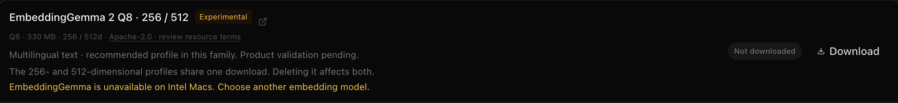
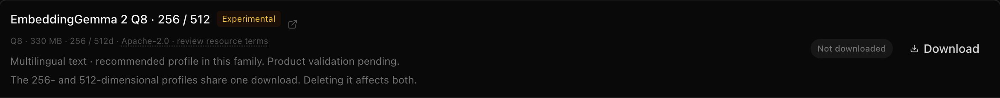

# Four-point correction preflight

The four requested corrections are implemented. This is a bounded regression and
isolated UI/IPC check, **not a new generated-answer campaign**. The closed
80-case baseline and its failed utility/absence gates remain unchanged;
`validatedProfiles` is empty and EmbeddingGemma remains experimental.

1. **QA admission and timing.** Every new producer must reserve a slot in the
   same explicit generator pool. Atomic leases prevent a third producer from
   sharing two generators. Host helpers record queue, reading, post-read-until-helper
   and delivery boundaries. Post-read includes generation, scheduling and tools;
   missing observations remain unknown. Queue/read deadlines are 60/90 seconds;
   the hard total remains 300 seconds. Original accepted requests survive
   abandonment. Expired/cancelled/terminal work cannot publish. Format `/4` adds
   these controls while historical `/2` and `/3` receipts remain readable.
2. **R007 loss diagnosed and corrected.** The exact captured writer already
   supplied `Cálculo: 72% − 51% = 21 puntos porcentuales…`. The auditor accepted
   the literal operands and derivation, but set `explicitInference=false`.
   The final guard removed it. An otherwise valid positive verdict that
   contradicts an explicit leading calculation label now gets one fresh
   sentence-only consistency audit. No flag is flipped automatically. A repeated
   contradiction, rejection, failed retry, unsupported assertion, nonliteral
   quote or invalid premise dependency still blocks publication. This applies
   across embedding models, without changing vectors or the final factual guard.
3. **Intel availability.** Both profiles are excluded from model choices and
   denied by download and both inference entry points before a transfer/worker.
   Settings explains the limitation in every language. Existing files remain
   removable; a saved choice is not silently switched. Unit tests cover the
   platform matrix and real manager/direct-host boundaries. Actual Electron
   verifies the UI and IPC under simulated Intel architecture, then restores ARM.
4. **Small reproducible preflight.** `npm run test:research:focused` covers the
   exact recorded R007 input/verdict, strict negative paths, cross-process pool
   admission and real local HTTP/file-queue lifecycle. `npm run
   test:research:corrections:e2e` uses actual Electron with an empty key file and
   the inherited OS sandbox; all 12 database opens remain in its disposable
   profile. No real vault, credential store, paid API or keychain prompt is used.

[Verification receipt](verification.json) binds source hashes, build and test
results, the captured auditor request/raw response hashes, and the
[Electron receipt](corrections-ui.json). Focused, Luna, grounding and embedding
contract suites pass; the captured-calculation retry replies are synthetic.
TypeScript, scoped ESLint and the production build pass. The initial UI assertions
passed but its Intel screenshot was obscured by the dialog opened by a deliberate
IPC rejection; the final test closes that dialog before capturing the card.

| Intel availability simulation | Actual ARM availability restored |
| --- | --- |
|  |  |

A real fresh Luna generation preflight and prospective answer-quality campaign
are still required before claiming generation reliability or improved whole-cohort
accuracy. Windows/Linux real-weight package checks remain pending. Native Intel
inference is unavailable with the pinned runtime, not inferred from an app build.
The prior 31-request targeted campaign remains closed incomplete with zero
published answers; none is retried, credited or regraded by these tests.

DeepSeek remains closed at USD 7.9559/8. OpenRouter remains USD 0.09287637/0.50;
the conditional extra EUR 0.50 remains unused. This preflight made zero new model
calls and zero paid calls. The [runtime documentation](../../../docs/embeddinggemma-2.md)
contains the separate commands, pool setup and remaining release gates.
