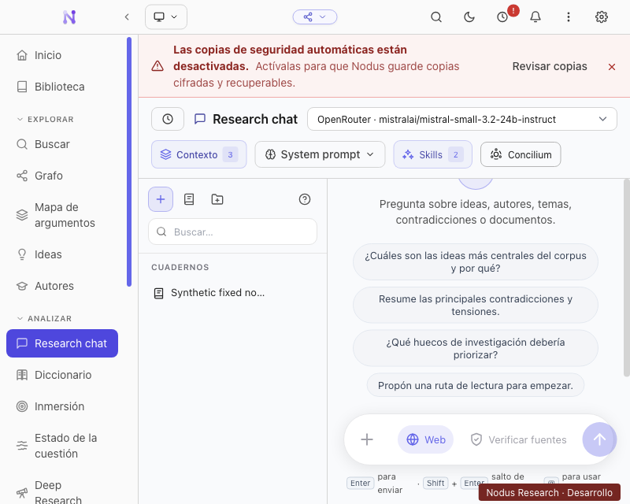
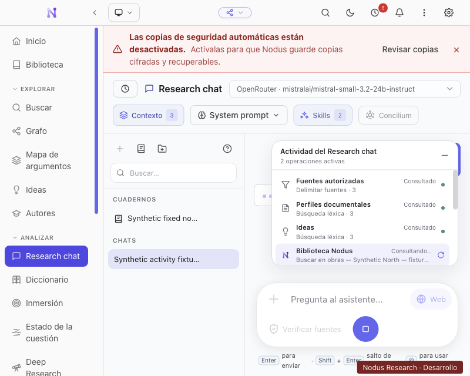
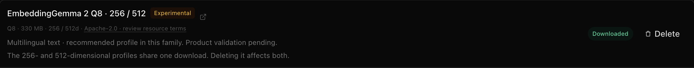

# Merged-main verification

The [later closeout](../targeted-2026-10-15/README.md) supersedes this report's
initial assumption about the alias's native directory: ONNX 1.30 uses `napi-v6`,
and its npm artifact has no macOS Intel binding. A fresh package and actual-file
checks verify corrected native-slice pruning. The receipts below remain bound
to their originally recorded build.

The branch incorporates `main` at `560812e2`. The merge preserves the pinned
EmbeddingGemma alias in the centralized main-process dependency closure,
including its undeclared `onnxruntime-common` import and nested native ONNX
runtime. Electron-builder matcher tests cover retained Node builds, rejected
browser bundles and foreign native slices for macOS ARM64/x64, Windows x64 and
Linux x64. These matcher tests are not native execution on those other hosts.

The real isolated Electron smoke exposed an editable field shrinking to zero
beside history and verification controls. Controls now wrap within the available
chat width; the real UI test also checks a usable input bounding box. Notebook
filters, verification opt-in, activity/failure/cancellation, PDF page/original
access and light/dark layouts pass at 1280×800 and 800×640. All 23 database opens
stay inside the disposable profile; no model generation or credential read is
needed. The corrected narrow screenshot was inspected.

A fresh macOS ARM64 ASAR passes offline real Q8-512 and Q8-256 inference and
semantic search in its separate utility process. Switching dimensions requires
explicit preparation. The shared download card, experimental/resource-terms
wording and cancelled shared deletion checks pass. Weights are hash-verified
copies between marked QA roots and are not bundled. The packaging hook also
loads the retained runtime packages and verifies the bundled server and native
architecture. Its screenshots were inspected.

The first packaging tool process hung on shutdown in Node 24.19.0's V8 background
compiler, after checking all Drift files. Its log and process sample remain
recorded. Rebuilding with the installed Node 22.13.1 passed; the application
runtime remains Electron 43.6.0 / Node 24.20.0. Both failed UI attempts also
remain recorded. No original failed attempt is rewritten as success.

`verification.json` binds source, test, build, UI and package receipts. Type,
lint, grounding, retrieval, embedding contracts, process, citation/context,
package closure and QA protocol checks pass. This verifies the recorded merged
implementation; it does not establish a new generated-answer quality rate.
The closed 35/60 positive and 13/20 absence results remain unchanged. A targeted
five-case fresh-generation diagnostic is a separate regression, not a holdout
or full-cohort acceptance result. Other native model/package hosts, complete
model comparison/capacity gates and concrete upstream resource-term clearance
remain pending. No additional paid provider call was made.

## Isolated UI evidence

Before: the narrow field has no editable width.

After: controls wrap and the field remains usable beside the history sidebar.

The actual packaged model card preserves shared download and experimental status.

