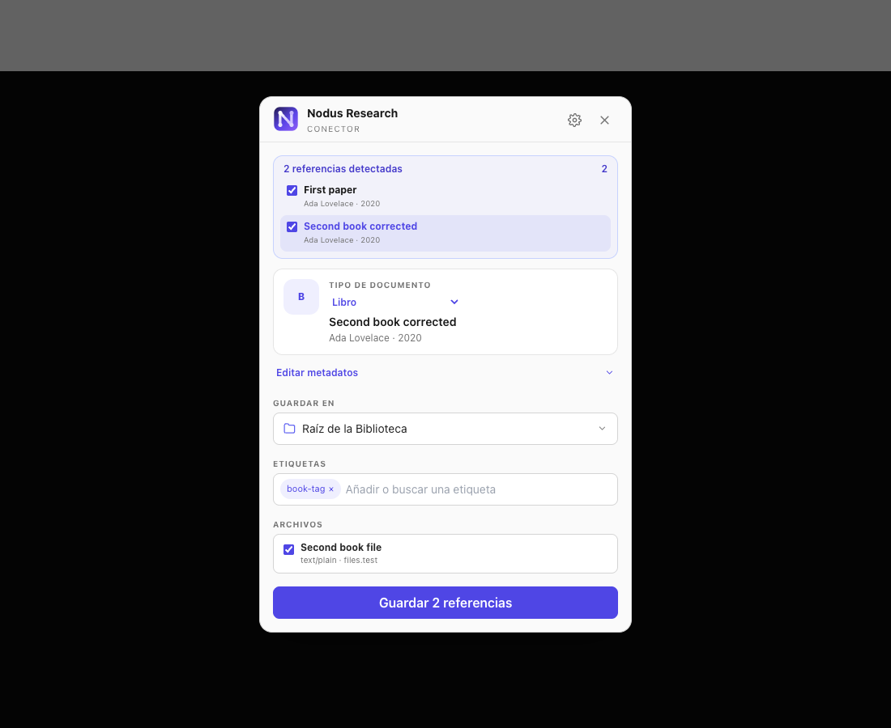
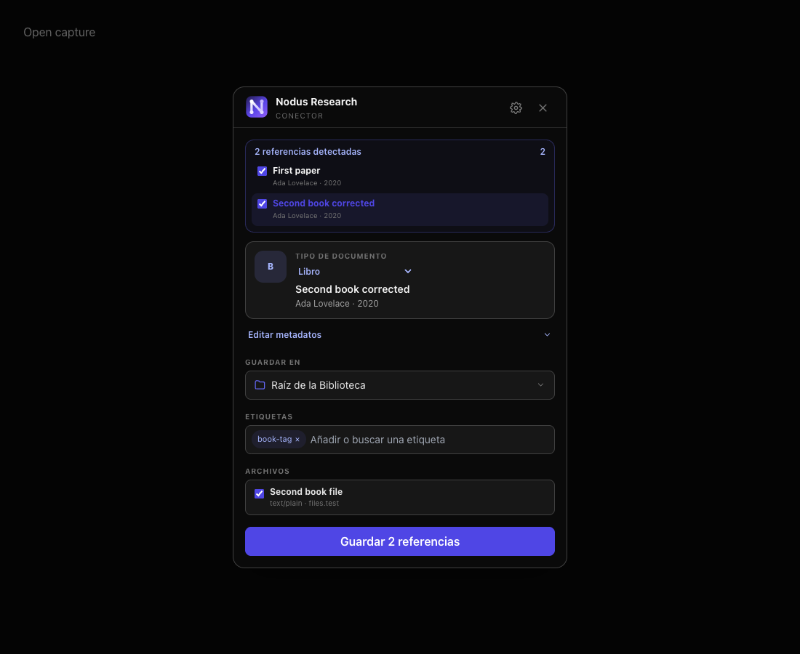
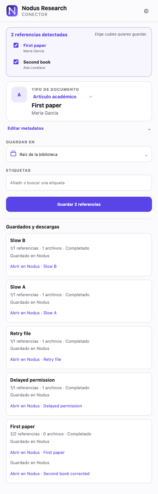

# Browser connector architecture

Nodus Connector is a user-initiated bibliographic capture path for Chrome. It follows the useful
separation found in Zotero Connector—page detection in the browser and durable library operations in
the desktop application—without copying Zotero code or requiring the Zotero client.

The extension's injected collector gathers bounded metadata standards and candidate links. A pure
detector normalizes them to Nodus' Zotero-compatible item types. The popup is the review boundary:
no item is created until the user confirms the type, collection, tags, files, and optional snapshot.

The desktop application listens only on `127.0.0.1`. Browser endpoints accept only browser
extension origins, require a dedicated constant-time-checked bearer token after pairing, reject
web origins, and never expose the Zotero plugin token. The signed Chrome Web Store build is
identified by extension id `ilcclajjhofhieoljdjmikmfopfbamej`. Pairing is still an explicit native
Nodus confirmation, including for that official id: localhost HTTP headers can be forged by a
local process, while the native confirmation binds the issued credential to the exact canonical
extension origin. This also provides the supported path for unpacked/development builds.

Nodus stores one approved extension origin alongside the connector token. Every capability
request (catalogue, capture, save, open, and attachment upload) must present both the token and
that exact origin; another installed extension cannot reuse the token or take over the pairing.
Health remains available before pairing so the extension can discover Nodus, while `/pair` is the
only route that can establish the binding. Any later caller that asks `/pair` to reveal the secret
without already proving possession of it raises native confirmation again; the compatibility
origin marker is never sufficient to recover a credential silently. Revocation rotates the secret,
clears the approved origin, and requires a fresh native confirmation.

Nodus first attempts to retrieve public attachment URLs itself, with DNS and redirect checks that
block private-network requests and a 64 MiB limit. If a publisher requires the current browser
session, the extension may request optional permission for that exact origin and upload the selected
file to the loopback endpoint. Newly granted site access is revoked after transfer; an on-demand
Manifest V3 service worker owns long transfers so popup closure does not cancel them. All files
enter the existing attachment service, which preserves the original and queues clean-reader
extraction. HTML snapshots are bounded reader-style documents built from the main article text,
without executable code, styles, forms, frames or remote media.

Server integration tests always use a temporary application profile, backup root, and synthetic
Library. The connector has no code path that writes to a Zotero database or source vault.

## Chrome and Nodus Browser parity contract

Nodus Connector has two trusted user interfaces over the same capture product:

- `browser-extension/popup.*` is the Chrome adapter. It must discover, pair and authenticate with
  the desktop application because it runs outside Nodus.
- `src/components/browser/BrowserCaptureModal.tsx` is the adapter built into Nodus Browser and is
  opened by the N icon in its trusted toolbar. It does not pair over a port and is not an extension.

Those connection mechanics are the only intended functional difference. Document-type choices,
bylines and glyphs come from `browser-extension/lib/presentation.js`; collection hierarchy/search
and tag normalization come from `browser-extension/lib/collections.js`; detection and durable
Library writes already share the detector and `electron/browser-connector/libraryCapture.ts`.

Those shared modules stay language-neutral because they also run outside a browser surface: they
default to English labels and take the ones their caller renders, so the Chrome adapter reads its
`_locales` catalog and the integrated dialog passes its own. A user-visible string added to a shared
module belongs in every adapter's catalog, never hardcoded in one of them.

Document-type names follow the same rule through `presentation.js`, which carries the table for every
language either adapter renders and is the one vocabulary both share. The Chrome package keeps the
rest of its copy in `_locales`, one catalog per language. Its list covers the nine interface
languages and four more the extension carries ahead of the interface, so a language the desktop has
not reached yet is a catalog and a table entry here, never a second copy of the same strings.

**Maintenance rule:** any Connector capability, field, state or review-flow change must be applied
to both adapters in the same pull request. Do not copy the shared behavior back into either UI.
Extend a pure shared module or the common capture pipeline first, then update the two thin adapters.
`scripts/test-browser-connector.mjs` enforces the shared imports and the integrated toolbar entry so
a future one-sided change fails CI rather than silently breaking parity.

The integrated dialog belongs to the trusted Nodus renderer. Arbitrary pages remain in their
sandboxed Browser WebContents, receive no Nodus preload API and cannot open, populate or submit the
dialog. Page metadata is still treated as hostile and passes through the same bounded sanitizer in
the main process before preview and again before saving.

## Reviewed captures and durable jobs

Both adapters use `lib/capture-review.js` for per-reference metadata, tags, files and
snapshot choices, and `lib/capture-jobs.js` for durable progress. Reviewed values skip
provider enrichment on save. The shared metadata form preserves creator roles, including
editors, while names are edited. Multi-record detection marks listing URLs so the Library
never treats a shared search URL as document identity. A persisted job/entry request id
makes an uncertain save acknowledgement safe to replay, even without bibliographic identifiers.

Chrome persists each job under its own storage key before starting any network work. The
worker also owns pairing and token persistence. A bounded keepalive runs only during active
user-requested work; startup and a recovery alarm resume interrupted jobs. Failed records
and files wait for an explicit retry; successful records are not re-submitted. Only newly
requested optional hosts are revoked, once no active transfer needs them. Permission requests
run synchronously in a new “Authorize and download” click, after pending hosts have been
computed. This avoids losing Chromium's user gesture during slow public-download attempts.

The built-in Browser uses the same queue in the main process, with atomic per-job files in
`userData/browser-capture-jobs` and the Browser session for authenticated attachments. Its
list/enqueue/retry IPC routes require the trusted main-frame sender. Both histories keep the
latest 20 completed jobs; incomplete work remains available for recovery and retry.

Verification includes `test-browser-capture-jobs.mjs`, `test-browser-extension-worker.mjs`,
`test-library-browser-dedup.mjs`, `verify-browser-capture-jobs.mjs` and the three scripts behind
`npm run test:e2e:browser-connector`. The native recovery suite loads the actual extension
in an isolated Chromium profile, uses native runtime/storage/permission APIs, closes the
popup during pairing and saving, and restarts Chrome with an unfinished download. Its visible
mode also checks native host approval and revocation. All Library integration tests use
synthetic records and disposable backup/profile directories.

The following screenshots use only synthetic references. The integrated review keeps
the second reference's title, tags and selected file independent of the first; the
Chrome history shows completed work after closing the popup and restarting Chromium.

