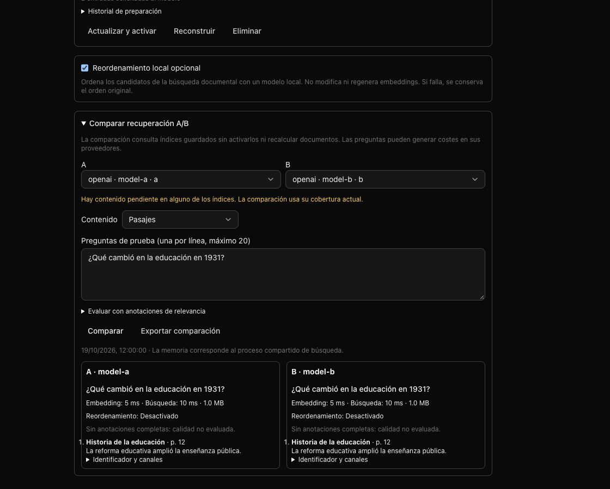

# EmbeddingGemma 2 Desktop

EmbeddingGemma 2 is an additional, experimental local text encoder. Existing defaults and historical embedding preparation remain unchanged. A successful runtime smoke or short controlled retrieval benchmark does **not** mark a profile validated. Product quality, grounding, scope isolation and native packaging gates must all pass first.

## Immutable profiles

| Profile | Native encoder | Output |
| --- | --- | --- |
| `embeddinggemma-2-text-q8-512-v1` | ONNX Q8, CPU | 512, then L2 |
| `embeddinggemma-2-text-q8-256-v1` | Same assets | 256, then L2 |

Both profiles resolve to `embeddinggemma-2-text-q8-v1` on disk. Download, progress, cancellation and deletion operate on that family. Neither profile installs vision or audio encoders. Each resource records its Apache-2.0 declaration, upstream license URL and packaged notice, and is pinned to revision `daa72c51243991dfcaf9f9137d2c573d8f7790c0`, size and SHA-256. Deleting the weights affects both profiles, including a selected profile. Corrupt or incomplete assets fail verification before inference.

The exclusive npm alias `@nodus/embeddinggemma-transformers` pins Transformers.js **4.3.1**. Other consumers retain their existing Transformers.js dependency. The standalone `embeddingGemma2Worker.cjs` is built into `dist-electron`; the alias and both versions of ONNX Runtime’s native libraries are unpacked from ASAR. A missing or unsupported runtime fails explicitly. No automatic precision or model fallback is permitted.

The pinned alias resolves ONNX Runtime Node **1.30.0**, whose installed npm
artifact contains `napi-v6` CPU bindings for Windows x64, Linux x64 and macOS
ARM64, but **no macOS x64 binding**. EmbeddingGemma is therefore unavailable on
Intel Macs with this dependency set. Both profiles remain visible with a localized
unavailability message in Settings, but are removed from embedding choices;
download and both inference entry points reject before allocating a worker or
transferring assets. Existing weights remain removable and a saved selection is
never silently changed. Intel support requires an explicitly built
and independently verified compatible native runtime; it cannot be inferred from
an Intel Nodus build or provided by silently loading the historical ONNX runtime.
Installer tests inspect actual native files for both runtime versions rather
than assuming matching paths. CI skips optional CUDA downloads for its CPU tests;
this does not change the selected model, precision or CPU inference.

Queries use `task: search result | query: `; documents use `title: … | text: `, with `none` when no title is available. The model’s `sentence_embedding` output already includes its pooling/projection. The worker checks the native 768-component output, performs Matryoshka prefix reduction, then L2 normalization. Counts, dimensions, finiteness and nonzero norms are checked before publication.

Tokenization includes prompts and special tokens, with truncation disabled. More than 8,192 tokens produces an explicit error. Documentary preparation’s existing UTF-8 bounded, locator-preserving chunks remain below this limit; an indivisible excessive title/input is rejected. Historical models retain their previous 8,000-character preparation.

Legacy Transformers models now dispatch at most eight inputs and 2,048 padded tokens per native call, with larger inputs individually. Their tokenizer, text, pooling and normalization are unchanged. Real Electron runs exposed native allocator crashes with large E5/GTE batches; changing dispatch bounds addresses those crashes without assigning new vector semantics to historical indices.

There is one isolated utility process for this asset family, hosting a Node worker thread for native ONNX, with one active operation, at most four CPU threads and query priority between inference batches. Batches contain at most eight entries with a maximum padded input cost of 2,048 tokens; longer entries run individually. Cancelling active native work terminates its process and preserves queued independent requests. Invalid or oversized inputs fail their own request. Runtime crashes reject outstanding work without changing the selected profile or quantization; a later explicit request can recreate the process. The ready handshake is bounded, idle processes terminate after five minutes, and application shutdown closes them. Native failures are contained outside Electron's main process.

## Index identity and publication

`shared/embeddingGemma2.ts` constructs the existing nine-field embedding contract. It records weights/tokenizer revision, precision, dimensions, both prompts, special tokens, maximum context, projection, reduction and normalization. Changing any vector semantics requires a **new profile ID**, even if dimensions remain the same.

Each vault keeps independent saved embedding indexes, with one active index for the desktop. Their identity includes the normalized provider endpoint, model revision when available, complete vector contract and versioned input recipe. Local vectors are stored by index, generation, family and item; shared documentary vectors use explicit revision references. Legacy vectors are inventoried from their actual metadata and ambiguous groups remain unavailable for activation until rebuilt. No dimension-only compatibility is inferred.

In Settings, select a destination model to preview reusable, pending and excluded content before choosing **Prepare and activate**. The previous index remains active during preparation. Preparation uses available text and respects the destination provider's permissions; it does not trigger analysis, OCR or transcription. Returning to an unchanged saved index activates it without provider requests. Pausing, cancelling or restarting preserves confirmed work. Only the active index receives automatic maintenance. Deleting an index requires the vault-style confirmation sequence; deleting the active index explicitly leaves semantic search disabled while preserving documents and text search.

E5, Nomic, native Gemini retrieval tasks and the fixed EmbeddingGemma 2 templates have separate query/document recipes. Custom prefixes are available in the advanced input profile controls. Existing indexes retain their original recipe; changing a recipe prepares another compatible index rather than silently reinterpreting stored vectors. Preparation history records its trigger, reviewed/reused/computed/excluded/failed counts and requested model inputs. Recovery and retries retain confirmed counters.

The optional local documentary reranker requires an explicit model download and never regenerates embeddings. It processes at most 30 candidates with bounded input length and a deadline; unavailable, failed or stale reranking preserves the hybrid order. The A/B comparison queries two saved indexes without activating them, exports their contracts and results, and reports quality only for complete relevance annotations. Source, vector or documentary-reference changes invalidate an in-flight comparison. Performance fixtures use synthetic passages and seeded vectors; they do not establish model quality on a research collection.

Encrypted backups include active and saved indexes, preparations, run history and documentary references even when conversation histories are omitted. Remote publication exports only the explicit active index and eligible shared content. Content, contracts and vector matrices commit together; a failed publication keeps the previous complete remote version. Publishing without an active index removes previous remote vectors. Classic servers must support atomic embedding publication before accepting an index switch.



Notebook creation counts use the same readiness check as the backend, including missing, partial and incompatible vectors; a lexical publication alone does not count as prepared while embeddings are expected.

Execution captures vault path, configuration/endpoint and an embedding settings revision for every provider. Query execution also captures a live vault epoch, so switching away and back rejects the original result. Document publication checks the owning scope, source revision and selected contract. Settings revisions include a process session: held work cannot publish after a configuration change, while persisted jobs can resume after restarting with the same contract. Full contracts accompany server vector exports; transport `int8-l2` is separate from encoder Q8 precision. Server index locks and contract-aware queries remain mandatory.

The opt-in `NODUS_EMBEDDING_QA_TRACE=1` is accepted only with a matching isolated manifest/profile. Its trace records the query, selected profile/contract, compatible vector revision keys, semantic/lexical candidates, evidence selection and incomplete preparation. Content-bearing traces are never enabled in an ordinary profile.

## Isolated validation

Use Node 22.12+ and rebuild native SQLite for the installed Electron version:

```sh
npm install
npx electron-builder install-app-deps
npm run test:embeddinggemma:contracts
npm run test:embeddinggemma:process
npm run test:embeddinggemma:runtime
npm run audit:embeddinggemma -- --all
npm run test:e2e:embeddinggemma
```

### Focused correction preflight

Run the bounded regressions before scheduling another answer campaign:

```sh
npm run test:research:focused
npm run test:research:luna
npm run test:research:grounding
npm run typecheck:ci
npm run build
npm run test:research:corrections:e2e
```

The last command launches real Electron under the macOS isolation boundary with
empty harness keys. It verifies UI and IPC denial under a simulated Intel
architecture and restores the actual ARM architecture to check availability.
It does not claim native Intel execution. The captured R007 auditor regression
uses exact recorded inputs/verdicts; its retry replies are synthetic. No test
above measures a new generated-answer accuracy rate or calls a paid provider.

R007's operands and requested calculation reached both planner and writer.
The writer correctly labelled `72% − 51% = 21` as a calculation. The auditor
accepted its literal operands and derivation, but returned
`explicitInference=false`, causing the deterministic guard to remove it.
A leading calculation label with otherwise valid support now receives one
fresh sentence-only consistency audit. The code never flips that flag to
approve the sentence. A repeated contradiction, rejection, missing literal
quote, unsupported assertion, invalid dependency or failed retry still blocks
it. This correction applies to documentary verification with any embedding model.

New live Luna campaigns require one shared generator pool across all producer
processes. Create a marked disposable root with `createResearchTestRoot()` from
`scripts/research-isolation.mjs`, then initialize its capacity once:

```sh
node scripts/lib/researchLunaAdmission.mjs --root=/ABSOLUTE/MARKED/QA/POOL --slots=2
```

Pass `--generator-pool-root=/ABSOLUTE/MARKED/QA/POOL` (or
`NODUS_QA_GENERATOR_POOL`) to every live-answer producer, alongside its existing
qualified clone/source arguments. Each producer holds one exclusive slot for
its segment; a third producer cannot run against two slots. Normal exit releases
it. A crashed producer leaves its lease for explicit operator review, with no
automatic PID-based reclamation or duplicated generation.

Dispatch jobs use format `/4`; `/2` and `/3` remain readable for historical
receipts. The generator's first helper records `reading-started`. After its
complete hash-bound multipart read and read attestation, a second helper records
`reading-completed`. The exact-response helper records `response-ready` before
publication. The bridge records final delivery/abandonment. The campaign saves
per-request execution timings: queue, reading, post-read-until-helper, delivery
and total. Post-read time includes model generation, scheduling and tools; it
is not claimed as native inference latency. Missing boundaries remain unknown.
New live requests fail after 60 seconds in queue or 90 seconds reading, and the
hard total remains **300 seconds**, including all stages. Nothing extends the
production model timeout. Helpers refuse expired/cancelled/terminal work;
original request bytes survive abandonment for diagnosis. Closed baseline and
failed campaign receipts are never rewritten or given new quality credit.

`npm run audit:embeddinggemma:process-parity` defaults to a dry run. Its explicit `--prepare` and `--run --root=…` phases verify owned isolated assets, compare the same Q8 weights through the direct-thread reference and the isolated production-source host at both dimensions, then kill only the recorded QA utility process and check that the application and the same profile recover. See [the current campaign receipts and limits](../audit/research-live-quality/README.md); numerical parity, answer quality and packaged-platform coverage are separate checks.

Commands create marked roots under the OS temporary directory and retain artifacts for inspection. Every model uses its own process, profile, library, caches and stores. The macOS sandbox proves outside writes, descendant writes, external network and unauthorized loopback denial before launch. The sentinel is deliberately created outside QA’s inherited TMPDIR. Other operating systems require a native disposable environment with equivalent enforcement; they are not inferred from macOS results.

The product runner copies only the authorized **encrypted DeepSeek credential**, before Electron starts. It never loads a real registry, settings database, vault or secrets migration code. Only `deepseek-flash` is allowed by its paid proxy, at most two paid calls in flight across all proxies/processes of the campaign, with an originally **USD 5 campaign ledger**. The precision follow-up received explicit authorization for a final cumulative USD 8 ceiling, preserving every earlier call and unknown reservation; that campaign is now closed at USD 7.9559 committed. See [the closure record](../audit/research-chat-grounding/cost/closed-campaign.json). An atomic two-slot file gate and reserved upper-bound costs enforce the limits. Pass the same `--campaign-root` to subsequent authorized profile runs; a stage or larger caller limit cannot reset or raise the ledger. No OpenRouter credential or remote embedding route is admitted. Model downloads are byte-forwarded from an allowlist of pinned upstream URLs through a disposable loopback proxy; the proxy does not publish or retain weights.

```sh
node scripts/embeddinggemma-qa.mjs corpus
node scripts/embeddinggemma-qa.mjs replay-corpus --manifest=audit/embeddinggemma-2/corpus-manifest.json
node scripts/embeddinggemma-qa.mjs audit --all
node scripts/embeddinggemma-qa.mjs prepare-child --root=/absolute/marked/qa-root --profile=embeddinggemma-2-text-q8-512-v1 --audit --capacity --persist-capacity
node scripts/embeddinggemma-qa.mjs prepare-child --root=/absolute/marked/qa-root --profile=embeddinggemma-2-text-q8-512-v1 --context
node scripts/e2e-embeddinggemma.mjs --profile=embeddinggemma-2-text-q8-256-v1 --corpus-root=/absolute/marked/corpus-root --campaign-root=/absolute/marked/campaign-root
npm run test:embeddinggemma:capacity -- --capacity-root=/absolute/marked/qa-root --contention=quiet
npm run test:embeddinggemma:restart -- --model-root=/absolute/marked/qa-root
npm run test:embeddinggemma:server
npm run test:embeddinggemma:server:native -- --product-root=/absolute/marked/completed-product-512
npm run test:embeddinggemma:package -- --executable=/absolute/Nodus.app/Contents/MacOS/Nodus --model-root=/absolute/marked/qa-root
```

The corpus has 30 synthetic fixtures and ten hash-pinned public PDFs, matching 12 digital PDFs, six scanned PDFs, six DOCX, four EPUB, four Markdown, four TXT, two CSV and two XLSX. Gold facts and 120 queries (40 development, 80 evaluation) stay in `artifacts/`, outside the imported files. The controlled lane uses authored/curated short excerpts; the product lane imports and extracts the actual originals, including local OCR. This distinction must remain visible in every report.

The product runner exercises visible model download, both profile selections and Library import, then checks actual extraction/OCR before preparing vectors. It creates academic manual/automatic vaults and fixed/linked notebooks and measures the 120 queries against the extracted corpus. Lifecycle checks cover incremental additions, title/text edits, original replacement, delete/restore, fixed membership, exclusion revocation and scope isolation. Real native worker termination, simulated allocation failure and held inference test recovery and stale-result rejection. Offline local search permits only BGE’s own sandboxed llama.cpp loopback transport. Academic processing exercises passages, ideas, summaries and document profiles on one representative source per configuration with the same DeepSeek model; all forty originals undergo extraction and documentary vector preparation.

Research Chat runs twelve scenarios twice through the UI, captures actual IPC responses and retrieval traces, opens citation dialogs and records screenshots. An attachment test covers plain filename citations in a general conversation, followed by explicit promotion of the file into a fixed notebook to test semantic indexing, clickable citations and access revocation. Notebook membership intentionally excludes unpromoted conversation files. Generative grounding failures remain recorded even when retrieval and citation resolution succeed. `completed` means the runner’s actions completed, never that all release gates passed. Do not rebuild Vite while a product run is open: replacing its hashed UI resources invalidates the run.

Capacity uses 1,000 and 10,000 real generated text embeddings, and 50,000 vector comparisons. `--persist-capacity` retains native float32 vectors and their texts. The separate Desktop capacity runner loads these into the production documentary store under a complete explicit QA identity, then measures cold and twenty hot queries with distinct request suffixes and token counts including prefixes/special tokens, native semantic participation, renderer frame gaps, process memory and SQLite size. Its injected chunks are a capacity fixture, not extraction/quality evidence. Label concurrent-load measurements separately from a quiet reference run. Resident memory can decrease under compression; per-process peaks are not a simultaneous application total. The 50K JavaScript scan is reported separately.

The restart runner kills only its own marked Electron process during held native inference, verifies that vectors remain incomplete and resumes persisted preparation after a new process session. The server contract tests check full-contract locks, same-dimension incompatibility and transport quantization. The separate native-server runner reads an actual completed QA vault, uses Desktop’s exporter and a real ONNX query, and publishes to a disposable server to compare exact/transported nearest results. It never reads a real vault. The package runner uses the actual ASAR application under the same OS boundary and checks both profiles offline.

The archived campaign includes the exact thirty generated fixtures because PDF/ZIP timestamps make regeneration byte-variable. Replay verifies their hashes and downloads only the ten allowlisted, pinned public PDFs. Gold annotations stay outside imported files. Generate a durable report with:

```sh
npm run report:embeddinggemma -- --controlled-root=/absolute/marked/controlled-root --corpus-root=/absolute/marked/corpus-root --campaign-root=/absolute/marked/campaign-root --product-roots=/absolute/marked/product-512,/absolute/marked/product-256 --capacity-root=/absolute/marked/capacity-root --context-root=/absolute/marked/context-root --desktop-capacity-root=/absolute/marked/desktop-root --package-root=/absolute/marked/package-root --restart-root=/absolute/marked/restart-root --native-server-root=/absolute/marked/completed-product-512 --supplementary-desktop-roots=/absolute/marked/contended-desktop-root --reviews-file=audit/embeddinggemma-2/manual-reviews.json
```

Reports preserve individual answers, citations, traces, rankings, screenshots, cost bounds and classified failures. Manual reviews identify the reviewer, answer/source hashes and specific unsupported claims. A reviewed sample is not generalized to unreviewed answers.

The [model-independent Research Chat follow-up](research-chat-grounding.md) adds frozen-source redrafting, claim/quotation/arithmetic checks and exact coverage proof without rebuilding vectors. Its [final recorded regression](../audit/research-chat-grounding/README.md) remains below the required joint fidelity/adequacy threshold; profile validation remains withheld. On 2026-10-17 the user accepted the integration as experimental, with the incomplete validation recorded separately. Separate native 256-dimensional Desktop capacity now records hot p95 447 ms against 10,000 chunks on the M2/16 GB reference, with approximately 1 GiB sampled runtime resident-memory growth. Fixture generation was contended and is not a quiet indexing-throughput measurement. Other native operating systems remain pending.

## Experimental integration closeout (2026-10-17)

The [selected 37-case regression](../audit/research-live-quality/regression37-2026-10-15/README.md) closed incomplete: thirteen source-reviewed publications (eleven recovered failures and two controls), two verification-withheld cases, one protocol failure and 21 cases without final evidence. Original temporary profiles and raw transport/collector artifacts were absent on resumption; the preserved source packets and reviewer read receipts remain hash-verifiable. This does not revise the closed eighty-case baseline or validate a profile. The user authorized delivery and merge with these limits.

## Release gates

Validated profiles require Recall@10 ≥ 0.85; 512-dimensional nDCG@10 within 0.02 of correctly prepared E5 with no major-category regression > 0.05; and 256-dimensional nDCG@10 within 0.02 of 512. Citations must resolve 100%, at least 95% of factual answers must be supported and at least 90% of insufficient-evidence scenarios recognized. There must be zero contract/scope mixes and zero real database access. Review twenty answers and every grounding failure against actual source passages. Native and packaged inference smoke tests are required on Windows x64, Linux x64 and macOS ARM64. The pinned runtime does not support macOS Intel; that platform requires availability-denial checks and must not be advertised as supporting EmbeddingGemma inference. Future Intel support needs its own native and package verification.

The Apple M2/16 GB target is hot query p95 ≤ 1.5 seconds against 10,000 chunks and ordinary runtime memory growth ≤ 1.5 GiB. Report 2K/8K-token runs independently. Profiles remain experimental until all applicable gates have evidence; preserve failed results and do not replace an existing default.

## Provenance and terms

[Google’s model card](https://ai.google.dev/gemma/docs/embeddinggemma/model_card_2) and [upstream model repository](https://huggingface.co/google/embeddinggemma-2) identify Apache 2.0. [The official license](https://ai.google.dev/gemma/apache_2) is permissive and compatible with Nodus’s AGPL-3.0 code distribution when notices are preserved. The model card also says deployments must adhere to the Gemma Prohibited Use Policy. That additional sentence is not reconciled here with the Apache declaration; the terms of the specific text conversion require clarification before redistribution/mirroring. Nodus downloads from [the conversion origin](https://huggingface.co/onnx-community/embeddinggemma-2-ONNX) only on user request and does not ship weight copies. Model/Google attribution and notices from Transformers.js, ONNX Runtime and other dependencies are retained in the generated third-party bundle. Experimental availability is not a legal determination about unspecified future distribution arrangements.
