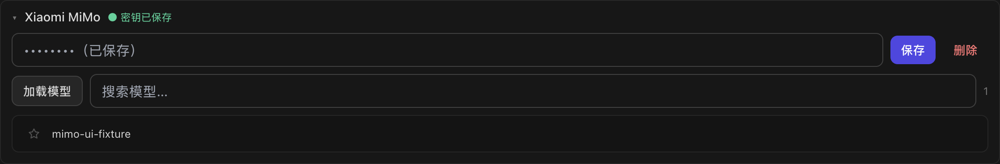
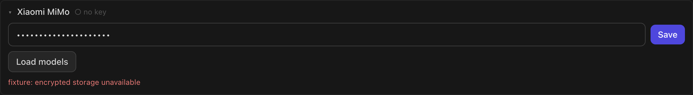

# API keys and built-in model downloads

In **Settings → AI Models**, **Load models** first saves any API key entered in the provider's field, then reads its model catalogue. **Save** remains available on its own. The saved-key indicator confirms local encrypted storage; it does not confirm the key's permissions with the provider.

If saving fails, Nodus shows the storage error, retains the typed key for another attempt, and makes no catalogue request. A missing key is explained before requesting a private catalogue. OpenRouter and OpenCode Go retain their public, keyless catalogues. HTTP 401/403 responses are shown as a key or permissions rejection, separately from connection errors.

Remote model catalogues and built-in model/runtime downloads use Electron's Chromium network stack, including the system proxy and certificate configuration, with cookies omitted. Ollama and LM Studio keep their direct local connections. API keys remain in the existing encrypted credential store.

Downloads keep their existing integrity checks and supported resume/cancellation behavior. Connection errors identify the host and an available transport error code, without exposing API keys, passwords or signed URL query parameters. A successful website visit alone does not prove that a model's download/CDN host is reachable.

## Focused verification

- `node --test scripts/test-model-catalog.mjs scripts/test-model-resource.mjs scripts/test-model-setup-proxy.mjs`
- `node scripts/verify-model-setup-ui.mjs`

The proxy test launches a real Electron instance with a disposable profile. An HTTP proxy serves only synthetic fixtures for `.invalid` hosts. It verifies catalogue loading, a redirected and resumed download, omitted request/response cookies, direct local providers, and a direct download after disabling the proxy. Downloader tests use small files to check cancellation, retries, size and SHA-256 rejection; no multi-gigabyte model or paid inference request is needed.

The UI verification renders the real settings component and application CSS in a disposable Electron window, with synthetic bridge responses. It verifies Chinese save/load and English storage failure, including call order and retention of the typed key.

These checks verify the corrected behavior and proxy compatibility. The original reporter's exact network failure still requires their app version, operating system and network configuration.
