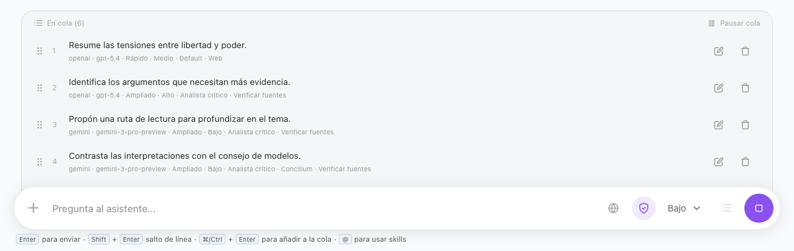

# Research chat in every vault

All nine vault types expose one **Research chat** entry under **Analyze**. Existing `dbChat`, `studyChat` and `worldChat` route IDs remain valid; academic, genealogy, primary-source, prosopography and testimony vaults use `researchChat`. The header and command-palette assistant shortcuts open the corresponding integrated view.

`ResearchAssistantModal` renders both the standalone modal reference and the embedded view. The header, model selector, messages, copy/save/regenerate actions, skills and effort composer share the same JSX and styles. Embedded mode changes the outer frame and adds collapsible history and context panels. Panel state retains the existing database/study/world local-storage keys. Compact layouts overlay the context panel instead of squeezing the composer.

The database, study/teaching and world views provide `ResearchChatAdapter` implementations. They retain their existing stores, retrieval engines, source selectors and transports, including native database charts, study citations and world references/focus. Older conversations need no migration. Scope keys persist per turn so changing sources cannot feed previous out-of-scope turns back into the next request, including after reopening a conversation.

The academic source filter remains opt-in. Native source panels keep their existing context rules. All Research chat transports pass the explicit effort through `researchGenerationOptions`; non-chat Study Assistant requests retain their existing settings. Nodi is unchanged.

## Pending requests in Research Chat

In the native Research Chat, **Cmd+Enter** on macOS or **Ctrl+Enter** adds the
composer's request to its conversation's queue. The queue shows four rows at a
time and scrolls through additional requests. Drag a row by its handle to change
the execution order; a focused handle also supports the Up and Down arrow keys.
Editing a request keeps its position and original configuration, and restores
the composer's previous draft when saved or cancelled. Deleting a pending request
requires confirmation. Pausing or stopping generation holds the remaining queue
until it is resumed.

Each entry copies the model and provider, reasoning effort, Fast/Expanded mode,
selected custom system prompt and its instructions, Concilium membership and
chairman, source selection, web search and answer verification settings. It also
retains its attachments and explicitly invoked skills. Later composer changes do
not change pending entries. Completed answers are included in the next request's
conversation history. The Web and Verify Sources controls use icons with tooltips
and accessible labels.

Pending entries are stored locally in browser storage under keys containing the
vault and conversation IDs. Stored entries contain request text and preferences;
they are not synchronized or exported by this feature. Reloaded queues start
paused. A worker checks that the original vault is active before sending another
request. No database migration or new network service is introduced; processing
uses the selected existing chat provider and web-search settings.

Validation: `node --test scripts/test-research-chat-queue.mjs scripts/test-i18n-coverage.mjs`
checks queue snapshots, ordering, editing, cancellation, restoration, vault
isolation and translations. `node scripts/verify-research-chat-queue.mjs` operates
the production view against the renderer-only harness on localhost:5198, with
controlled responses and synthetic content. It covers both shortcuts, scrolling,
editing, deletion, mouse and keyboard reordering, per-request settings, sequential
history, stop/resume and compact/light/dark layouts without paid model calls.

## Zotero MCP access in academic research

Academic Research Chat and Deep Research consult the authorized Nodus indexes first.
Original-page reads use a local PDF when available and fall back to the managed Zotero
MCP when the original is only available through Zotero. A document imported from Zotero
does not by itself count as an MCP consultation: the activity panel marks Zotero only
when the connector is actually attempted. Startup failures are reported as errors,
and the answer's research log distinguishes local evidence, successful MCP reads and
attempts without readable pages. Zotero must be running for the local connector to work.

Immersion generation also uses this bounded research path, retaining its existing
profiles, topic ranking and graph. It adds citable source passages from the shared
index or original files; abstracts and generated notes are not treated as literal
source passages. The scope preview continues to retrieve existing material without
starting supervising inference or a Zotero MCP session. MCP access remains read-only,
limited to authorized documents and subject to the existing automatic-connection
preference. Research starts when the user sends a query or generates a session.

Regression coverage: `scripts/test-research-zotero-agents.mjs` exercises the three
production retrieval callers with simulated transport and disposable data;
`scripts/test-research-zotero-sessions.mjs` checks activity outcomes and session
ownership. `scripts/verify-managed-zotero-mcp.mjs` separately exercises the real
stdio runtime against a synthetic HTTP endpoint and PDF.

## Offline validation

- `node --test scripts/test-sidebar-vault-filtering.mjs scripts/test-view-registry.mjs scripts/test-world-chat-parity.mjs`
- `node scripts/verify-research-chat-views.mjs` against the renderer-only harness on localhost:5198: modal/composer parity, five visual variants, native histories/citations/sources, effort payloads and collapsible responsive panels.
- `node scripts/test-research-native-effort.mjs`: real database/world/study orchestration with intercepted completion transports, old models plus Sol/Luna/Astra, Standard and High.
- Existing provider contract/localhost transport, source-filter, partial-cancellation and chat-skills regression suites.
- `npm run build` includes renderer and Electron type checks.

These checks use local fixtures and simulated generation; they make no paid inference calls.

## The context balloon

The **Contexto** balloon of Research chat has two tabs. **Enfoque** offers three switches,
in the order the activity balloon lists what they read:

- **Ideas**: ideas, themes, contradictions, gaps, reading paths, authors and the graph that
  relates them, together.
- **Documentos**: the text of the works in the Nodus library and in Zotero, and their
  document profiles.
- **Búsqueda web**: the same setting as the composer's Web button.

Under them, **Fuentes autorizadas** summarises the works the **Biblioteca** tab allows
("Toda la biblioteca", or how many works the filter keeps) and opens that tab. In a
notebook's chat it names the notebook's sources instead. The former modes (Síntesis,
Huecos, Contradicciones, Lecturas, Autores, Documentos) and the per-section checkboxes are
gone; the trigger's count is the number of switches that are on.

The choice travels with the turn as `selection.layers` (`shared/researchContextLayers.ts`),
with the older section flags set to match, so every path that reads sections keeps working.
A layer that is off is not consulted at all, not merely left out of the prompt: with
Documentos off the corpus run asks neither the documentary store nor the supervisor, and
with Ideas off it reads no ideas and no graph. The activity balloon shows those layers as
**Desactivada**. With every switch off the answer comes from general knowledge, and the
model is told to say so at the start of the answer and to cite nothing.

Selections saved before layers existed have no `layers` and are read from their sections;
in an academic vault their documents were always read, so that layer reads as on. A new
chat starts with every layer on. Deep Research does not use the balloon and reads both
layers.

The activity balloon lists one slim row per layer: its mark, its name, its state and a
single line of detail (the operation, its count and the subject), cut with an ellipsis.

Validation: `node scripts/test-research-corpus-run.mjs` (each layer off, and all off,
against the real corpus run), `node scripts/test-research-system-prompts.mjs` (the
general-knowledge instruction), and `node scripts/verify-research-context-layers.mjs`
against the renderer-only harness on localhost:5198 (the switches by mouse and keyboard,
the request each turn sends, the shared web setting, the no-sources note, the authorized
sources row and the activity balloon's rows, in light and dark).

## File attachments

Research chat alone exposes an integrated + button for conversation-owned files. All four native engines consume the same extracted document/table content and provider-specific vision parts. See [Research chat attachments](research-chat-attachments.md) for formats, persistence, bounds and the verification matrix.

## Study and Teaching source organization

The manual context picker shares the vault's courses, subjects and nested folders.
Search matches titles, filenames, tags and organizational paths without requiring
accents or matching case. Group checkboxes select current matching, usable source
keys (including descendants); hidden selections survive filtering and collapsing.
A material shown in several locations is selected once. Existing conversations
continue to store explicit `sourceKeys`, so adding/moving a material does not alter
an already saved context. Unusable or excluded materials remain visible but cannot
be added as evidence. Virtual rows keep large catalogues bounded in the DOM.

Users can create or rename folders in the picker and move individual materials via
its action menu. Materials uses the same movement dialog. The
`moveStudyMaterialPlacement(id, placementId, destination)` IPC operation validates
and updates one placement transactionally, infers organizational ancestors, and
preserves other placements and document provenance. A null origin is allowed only
for an unfiled material; an existing destination is reused. Files, versions,
annotations, material IDs and vectors are untouched. The source catalogue and
retrieval cache refresh organization without requesting AI extraction or embeddings.

Generated ideas and evidence keep their original subject and material provenance
after relocating or unlinking a live material, including on later background
knowledge sync. Notes, questions and review progress are not moved automatically.
Explicit knowledge purge and material lifecycle cleanup retain their existing paths.

Validation: `node --test scripts/test-study-source-tree.mjs scripts/test-study-materials.mjs scripts/test-study-assistant.mjs scripts/test-study-knowledge.mjs scripts/test-study-search.mjs`
and `node scripts/verify-study-source-picker.mjs` against the renderer-only harness
on port 5197 (or `NODUS_VISUAL_URL`). The UI check uses 5,000 material fixtures in
Study/light and Teaching/dark, including keyboard navigation, selection, folder
management, failed/successful relocation, requests and citation navigation.

## Chat history: projects, folders, pins, notebooks

Every chat history that has a store of its own organizes its conversations the same
way Research Chat does, through the same history sidebar and the same rules. The history
has projects (flat: name, icon and colour), folders nested inside each project, up to five
pinned chats, archived chats kept out of the normal list, a notebook section, and search
across chats, projects and notebooks.

### Where each surface keeps its history

| Vault / surface | Conversation store | Projects, folders, pins | Notebook-equivalent |
| --- | --- | --- | --- |
| Academic, Genealogy, Primary sources, Prosopography, Testimonies (Research Chat) | `chat_conversations` in the vault's database | `research_chat_projects`, `research_chat_project_folders`, `research_chat_placements` | Research notebooks (collections of the research corpus); not offered in Genealogy |
| Databases | `database_chat_conversations` | `database_chat_projects`, `database_chat_project_folders`, `database_chat_placements` | `database_chat_notebooks`: a named set of databases |
| Worldbuilding | `world_chat_conversations` | `world_chat_projects`, `world_chat_project_folders`, `world_chat_placements` | `world_chat_notebooks`: a named set of world entries |
| Study | `study-chat-history.json` in the vault's folder | `projects` and `folders` in the same file; each conversation record carries its own `projectId`, `folderId` and `pinnedAt` | The vault's Courses → Subjects → Topics |
| Teaching | The same JSON store, in the teaching vault's own folder | As Study | As Study |

Genealogy has no chat store of its own: its chat is Research Chat with the family as
context, so its conversations, projects and folders are Research Chat's, in the genealogy
vault's database. Teaching's chat is the Study chat (`StudyChatView` with the teaching
variant), so it uses the Study store in the teaching vault.

The table-backed stores share one implementation (`electron/db/chatOrganizerRepo.ts`),
handed each surface's tables; the Study store implements the same operations over the
file (`electron/ai/studyChatHistory.ts`). All of them refuse with the same error codes
(`research_chat_folder_cycle`, `research_chat_folder_wrong_project`,
`research_chat_folder_not_found`, `research_chat_project_not_found`,
`research_chat_pin_limit`, …). Databases, Worldbuilding and Study are reached through the
`chatHistory:*` channels, which name their surface and refuse any other; Research Chat
keeps its `chat:*` channels.

### Folder rules

- A project is flat; its folders nest. A folder never moves into its own subtree, and a
  subfolder always stays in its parent's project.
- A chat's folder always belongs to the chat's project. Filing a chat in a folder puts it
  in that folder's project; moving it to another project (or out of projects) clears its
  folder; removing it from its folder keeps it in the project.
- **Deleting a folder** takes its subfolders with it and unfiles every chat that was in
  any of them: the chats stay in the project, under "No folder". It never deletes a
  conversation.
- **Deleting a conversation** removes its membership: its placement (project, folder,
  pin, notebook) goes with it, and it cannot be placed again.
- **Creating a folder** never moves an existing conversation into it; a new folder is
  empty until a chat is filed there (from the chat's menu, "Move to folder…", or by
  dragging it onto the folder).
- Deleting a project takes its folders and returns its chats to the general history;
  deleting a notebook returns its chats to the general history too. Neither deletes a
  conversation.
- At most five unarchived chats are pinned; pinning a sixth is refused with
  `research_chat_pin_limit`. Archiving a chat unpins it.

Every chat's menu has "Move to project" and, for a chat in a project with folders,
"Move to folder…": the project's folders in tree order, indented by depth, the current
one checked, and "Remove from folder" when the chat is in one. The menu works from the
keyboard: it takes the focus when it opens, arrow keys, Home and End move through it,
ArrowRight opens a submenu and ArrowLeft returns, Escape or a click outside closes it,
and the focus returns to the row it came from.

### Across devices

Folders, placements and the conversation tables are synced. Folders and placements carry
`updated_at` (migration 188 for Research Chat; the Databases and Worldbuilding tables were
created with it), so a chat filed or moved, or a folder renamed or reordered, travels by
the merge's newest-wins rule like any other row, and a deletion travels as a tombstone.

**When one device deletes a folder and another, before hearing of it, files a chat into
that folder, the deletion wins.** After the devices sync, in either order and whichever
edit was made later on the clock, the folder (and its subfolders) stays deleted on both
and the chat sits in the same project with no folder, on both. The chat is never lost and
never hidden. `scripts/test-chat-history-sync.mjs` runs the four orderings for each
table-backed history and checks, after every merge, that every conversation still exists,
that no placement names a missing folder or a folder of another project, and that each
chat is reachable in the history's own filter (a folder or "No folder").

A folder renamed or moved on one device after another deleted it follows the general
merge policy: the later edit brings the folder back, empty of the chats the deletion had
already unfiled.

The pin limit is enforced when a chat is pinned; two devices that each pinned chats while
apart can, after merging, show more than five until some are unpinned. No pin is dropped
automatically.

### The repair pass

A reference that does not resolve is repaired, not tolerated:

- **On initial load.** When a vault's database opens, every table-backed history is
  checked (`repairAllChatPlacements` in `electron/db/chatHistoryTables.ts`). The Study
  store repairs itself on every read of `study-chat-history.json` and writes the repair
  back, so the file on disk is sound after the first read.
- **After synchronization.** The same pass runs inside every merge (a `.nodussync`
  package or Nodus Server mutations), before the deferred foreign keys are checked and
  again after dangling rows are dropped. Without it a chat filed into a folder deleted on
  the other device made the whole merge fail its foreign-key check. The Study file is not
  row-synced; a restored or imported copy is repaired on its first read.

The pass clears a conversation's folder when the folder does not exist or belongs to
another project (the chat stays in its project, unfiled); clears a project (or notebook)
that does not exist (the chat returns to the general history); and drops the placement of
a conversation that no longer exists, or one left placing nowhere. In the Study file it
also drops a folder whose project is gone and returns a folder whose parent is missing, in
another project or in a cycle to its project's root. It never deletes a conversation, a
project or a folder, and a repaired table row is stamped so the repair itself converges
across devices.

### Differences between the surfaces

- **Notebooks.** Research Chat's notebooks read collections of the research corpus and
  are edited with the collection tree. Databases and Worldbuilding keep notebooks of their
  own, edited in the same dialog with the surface's picker (databases, or world entries);
  a chat inside one reads the notebook's current sources, its context panel says so, and a
  new chat is free of it again. Study and Teaching do not duplicate their organization:
  Courses → Subjects → Topics play the notebook's part. A chat lives in the course its
  scope reads, a course's page starts a chat scoped to the course, and search matches a
  course by its subjects and topics.
- **Moving notebook chats.** As in Research Chat, a chat inside a Databases or
  Worldbuilding notebook stays out of projects. A Study course is only a chat's current
  scope, which can change from one turn to the next, so a course chat can still be moved
  into a project.
- **Courses are managed in Study.** The history lists them and starts chats in them, but
  does not rename, restyle or delete them; that stays in the Study vault's own views.
- **Server sync.** The Databases and Worldbuilding tables travel in `.nodussync`
  packages with the rest of their sync group. Like Research Chat's projects and folders,
  they are not part of the Nodus Server mutable-table contract; `world_chat_conversations`
  already was, and its new `archived` column travels with its rows.
- **Older builds.** An older build reading `study-chat-history.json` ignores the
  `projects` and `folders` arrays and may write the file back without them; the next read
  by this build clears the conversations' now dangling references rather than hiding them.

### Validation

- `node --test scripts/test-research-chat-projects.mjs scripts/test-chat-history-surfaces.mjs scripts/test-chat-history-sync.mjs`:
  the shared contract (`scripts/lib/chatHistoryContract.mjs`) against Research Chat,
  Databases, Worldbuilding, Study and Teaching (the three folder rules, projects, pins and
  their refusal, archive, rename, the repair on load for a missing folder, a folder of
  another project and a missing project); isolation between surfaces in one vault and
  between vaults; the Study file's repair; the channels' refusal of unknown surfaces; and
  the two-device conflict for each table-backed history.
- `node --test scripts/test-research-chat-sidebar.mjs`: the history in a browser, including
  "Move to folder…" by keyboard alone, the rename of a pinned chat inside a project, and
  the course and surface-notebook variants.
- `node scripts/verify-chat-history-surfaces.mjs` against the renderer-only harness on
  localhost:5198: Databases, Study, Teaching and Worldbuilding in the real chat view
  (projects, folders from the keyboard, pins, rename, archive and notebooks or courses).
