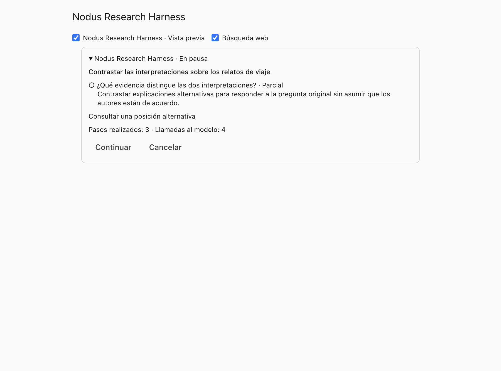
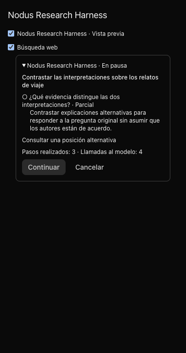

# Nodus Research Harness

The academic vault uses a shared V1 research execution across Research Chat,
Deep Research, Immersion and Dictionary. Fast/Expanded select investigation
breadth within this same engine. Legacy remains available through explicit
compatibility requests for rollback and comparisons; it is no longer a product
mode. Development comparisons are small samples, not universal quality guarantees.

## Investigation profiles

V1 shares one coordinator and the same source/citation contracts across two profiles:
**Fast** (`fast`) and **Expanded** (`expanded`). The two-option switch is directly
available in the Chat header and in Dictionary, Deep Research and Immersion. It uses
the active theme accent, supports native radio keyboard navigation, and is translated
into all twelve interface languages. Descriptive tooltips open on hover or keyboard
focus, explain the scope/time/resource tradeoff, fit narrow windows and dismiss on
Escape. There is no range slider or selection popover. The System prompt trigger
uses the same 36-pixel height and keeps its label on one line.

Chat and Dictionary start on Fast; Deep Research and Immersion start on Expanded.
Choices are remembered separately per surface, across vaults, in
`researchExplorationByMode`. Requests, including queued Deep Research MCP jobs,
can override them with `explorationMode`. This is independent of model thinking;
V1 no longer implicitly selects a light retrieval allowance from thinking-off.
V1 is the normal default. A one-time settings marker promotes old preview defaults; an explicit compatibility override made after that promotion remains available.

Expanded retains the previous V1 retrieval targets and adaptive margin. Fast narrows
candidate selection to at most 40, eight passages per round, 16,000 evidence bytes
and four initial round targets, preserving explicitly smaller settings. It keeps up
to two extra rounds and a 50% evidence margin for important unresolved questions,
subject to the existing window limits, and 96,000 decision bytes. Opening searches
are limited to two and one optional complementary branch is seeded. The agent can
still enqueue a useful related task, compare sources, read originals, use authorized
web tools, or finish early. These are operating allowances, never a requirement to
consume every step or relax evidential standards. Report/lesson writing remains
specific to those surfaces; profile selection changes investigation breadth.

The effective profile is saved in the durable request/context and shown in the
execution panel. Continuation preserves that choice and all consumed/narrowed
allowances, even if the user's current default has since changed. Deliberately
changing a request's profile requires a new investigation, so cached work from
one profile cannot silently be presented as another.

## Use and compatibility

- Choose **Fast / Expanded** in the research controls. New product requests use V1.
  Integrations and comparisons may explicitly select `harnessVersion: 'legacy'`;
  an internal `researchHarnessVersion` override remains available after promotion.
- Chat keeps its context controls. Deep Research and Immersion expose an additional
  web switch in v1, initially **off**. Web does not enlarge the authorized library.
- Expand the execution panel to see questions, queued work, consumed steps and
  model calls. Pause/continue/cancel apply to that execution. After restarting the
  app, an execution without a live worker appears paused and can be continued.
- Existing saved reports, sessions, conversations, citations and checkpoints remain readable. Compatibility requests do not change the product profile controls.
- A source, notebook, model, effort, instruction or conversation change can prevent
  continuation. Start a new request using the current context in that case.

The harness operates in the academic vault. Autonomous work stays inside the
current investigation; it cannot start independent reports, change filters, enable
disabled capabilities, write arbitrary files, execute commands or contact people.

## Execution model

`shared/researchHarness.ts` owns the serializable agenda and operational contracts.
`electron/ai/researchHarnessRuntime.ts` owns run identity, authorization validation,
model-call accounting, cancellation and completed semantic stages. A stage is reused
only inside its original request/context fingerprint. It stores application data,
not provider reasoning. Interrupted output is not a completed stage.

`ResearchCorpusRun` remains the evidence authority. The v1 coordinator sees the
enabled context layers, model/effort, source boundary, actual local and web excerpts,
unresolved questions, pending tasks and remaining allowance. It can search the
catalogue, retrieve indexed passages, read documents/originals, use granted web
access, enqueue complementary questions, defer unhelpful tasks and finish with a
reason. Actions use a closed schema and execute through backend permission checks.

Broad Research Chat questions now plan up to four complementary research lines,
each with its own question, source-language query, priority and purpose connecting
it to the user's objective. These are provisional facets, contextual questions,
contrasts or possible mechanisms, not findings. The model proposes questions;
query embeddings retrieve their evidence. Opening probes batch their embeddings
in order and leave a chunk and a round for later investigation. Pending lines
join the durable agenda; the supervisor can investigate, reprioritize or defer
them as evidence arrives. A focused query refinement keeps its task ID, question
and purpose; it cannot silently leave the original branch pending. Explicitly
deferring an optional branch does not prevent finishing an answered user objective.
The writer receives the agenda and must reconnect
useful findings to the original question, omitting adjacent material that does
not help answer it. Purpose is shown in the execution panel and never counts as
documentary support. Narrow facts, source-free turns, constructive exercises,
and disabled expansion do not open this branch queue. Indexed-only V1 can refine searches and queue relevant index queries within its grant; it cannot enable other layers.

The agenda deduplicates queries, prioritizes pending work and permits at most 32
questions and 64 tasks. Two actions without new evidence permit one strategy
change; continued stagnation ends research. Useful new evidence resets that
counter. Finish distinguishes sufficient evidence, exhausted sources, diminishing
returns, budget, interruption, context changes and technical failure. Evidence now carries its authorized document ID and the source menu prioritizes matched documents. A refused tool argument executes nothing and gets at most one corrected decision within the same allowance. Repeated refusals stop exploration for diminishing returns; real scope revocation still interrupts the execution. An agenda
assessment is operational state, **not** an independently verified quality score.

Retrieval rounds, evidence allowance and decision allowance belong to the entire
run. Evidence/decision text is conservatively counted in UTF-8 bytes, not estimated
monetary cost. Model requests are reserved durably before dispatch (32 for Chat,
256 for a report/session). Interrupted attempts keep consumed allowance; continuing
does not reset it. Discovery in long-form generators initially uses at most about
one third of the rounds, leaving room for section/station research. There is no
per-section budget reset. Context-window checks still apply to the complete provider
request. User retrieval values are advisory targets in V1. The agent sees both
those targets and the remaining operating allowance. It may investigate beyond a
target for a concrete unresolved question and an untried useful route; the backend
grants at most twice the evidence target and a finite round margin (never more
than 32 rounds), within the actual model window. The original targets remain in
the context. This allowance is granted once, persisted and never replenished per
query or continuation. Disabling automatic expansion still disables autonomous
follow-ups. Word-count and duration guidance do not invalidate grounded content.
Source permissions, capability switches, cancellation, provider spending and
technical context/output bounds remain strict.

## Verification policy

The shared decision policy now uses a compact supervisor view. It keeps diverse
source excerpts and the latest tool result visible, uses short request-bound
evidence IDs for coverage, and summarizes completed actions while retaining every
pending branch. IDs expand only through the exact supplied evidence map; unknown
or window-pruned aliases cannot claim support. The writer and checkpoint retain
the complete excerpts and canonical citation destinations. Redundant legacy-agent
instructions no longer accompany every harness decision. The agent is guided to
stop for an answered objective rather than consume the full allowance; retrieval
and model-call ceilings have not been reduced.

All four adapters initialize the shared decision allowance before restoring a
checkpoint. Continuation retains both consumed bytes and any narrowed decision
limit; an adapter cannot replenish it after restoration. The decision policy is
part of the request fingerprint, so incompatible previous decisions are not reused.

V1 never adds response checks beyond legacy. The harness adds an
investigation agenda, contextual tool choices and durable execution, not another
mandatory proof/rewrite/semantic-veto chain. Research Chat respects the existing
`researchAnswerVerification` setting: off adds no model audit, legacy uses the
existing documentary check, and structured uses the existing structured answer
path. Ordinary prose streams immediately when that setting is off. Citation
sanitization, source authorization, technical bounds, cancellation and specialized
skill checks still apply.

Reasonable inferences and comparisons may combine cited premises from different
sources. Their combined conclusion need not appear verbatim in a passage. Writers
distinguish their interpretation naturally from a source's explicit statement and
qualify it proportionately; they must not invent facts, quotations or demonstrated
causality. A successful execution is not an independent accuracy certificate.

The policy fingerprints changed to `legacy-parity-v1` (Chat/Immersion) and
`direct-evidence-v1` (Deep Research), so incompatible old preview checkpoints cannot
resume their previous audit policy silently.

## Grounding by surface

| Surface | v1 behavior |
| --- | --- |
| Research Chat | Keeps the turn planner, indexed-only policy, context switches, notebook/source restrictions, Concilium and skills. Uses exactly the same optional verification and citation-recovery path as legacy. |
| Deep Research | Shares one ledger and budget through discovery and sections. Keeps deterministic source/citation/structure guards and the evidence-informed writers. Removes overlapping model audits, automatic rewrites and sentence pruning; a continuous report contains its connected body, with summaries and source notes kept separately. Later web findings retain their actual web receipts, without fictitious local works. |
| Immersion | Retains curriculum/panorama/stations/contrasts/exam and the existing structural/literal-citation handling. Can investigate each station before writing, without an additional field-by-field model audit. Prepared inputs and generated phases survive continuation. |
| Dictionary | Explicit investigation and generation use the same agenda, related-query planning, original readers, web grant, accounting and checkpoints. Its own adapter pins term/aliases, editorial focus, source scope, language and detail; it retains Dictionary's existing definition, attribution, citation, version and author-card handling. No additional review chain is introduced. Background incremental scans stay local. |

Dictionary exposes the same profile switch and execution panel. Each run belongs to one
entry, including research-only scans; entry filters are applied before the saved
run list is bounded. Generation continuation uses the same per-entry queue and
broadcasts as initial work. A user pause is shown as paused rather than failed,
transient retries retain the same run ID, and late stopped-worker events cannot
overwrite the resumed job. Completed definition/grounding/author phases are reused.
Saving a version and its artifact identity is transactional, so continuation after
a save does not create a second version. Editorial/source changes reject an old
continuation, and deleting an entry removes its local research checkpoints.

Source existence alone does not establish entailment. The writer receives the
authorized evidence and provenance and must cite accurately, preserve actor/time
scope and distinguish source text, metadata, authored notes and its own reasoning.
Disabling optional verification does not enlarge source permissions or allow
fabricated citation destinations. Model-generated prose remains fallible; corpus
permission checks and citation receipts are deterministic guarantees, not proofs
of every interpretation.

## Persistence and API

Migration 202 creates the local `research_harness_runs` table. Its compact summary
is separate from the full checkpoint. Checkpoints contain the pinned request and
context, agenda, evidence receipts, traversal, used allowance, completed operations
and semantic phase results. They are local execution state, excluded from sync
allowlists. Deleting an owning conversation/report/session removes its checkpoints.
Saved academic reports and sessions carry optional `researchRun` metadata; old
archives require no conversion.

The local schema version is 202; the synchronization wire version stays 200.
This migration changes only a machine-bound table. Regression checks establish
that checkpoints enter neither sync packages, server publications nor mutation
outboxes, and that index-only v201 publications still reach a schema-200 peer.

The renderer API adds `listResearchRuns`, `getResearchRun`, `pauseResearchRun`,
`resumeResearchRun`, `cancelResearchRun` and `onResearchRun`. The MCP exposes
`nodus_list_research_runs` and `nodus_control_research_run` in academic vaults;
Deep Research requests accept `harnessVersion` and `webSearch`. Continuation uses
the same application services and shared Deep Research lane. Saving a resumed
report/session reuses its artifact identity instead of creating another copy.

## Verification

Run the focused functional checks with:

```sh
node --test scripts/test-research-harness.mjs scripts/test-research-decision-context.mjs scripts/test-research-harness-evaluation.mjs scripts/test-research-verification-parity.mjs scripts/test-research-blind-judge.mjs
node --test scripts/test-dictionary-harness.mjs scripts/test-dictionary-generation-queue.mjs scripts/test-dictionary.mjs scripts/test-dictionary-ui.mjs
node scripts/test-research-expansion.mjs
node --test scripts/test-research-actions.mjs scripts/test-research-corpus-run.mjs scripts/test-research-source-filters.mjs scripts/test-research-chat-agent.mjs
node --test scripts/test-research-claim-audit.mjs scripts/test-research-claim-audit-batching.mjs scripts/test-research-request-budget.mjs
node --test scripts/test-deep-research.mjs scripts/test-deep-research-quality.mjs scripts/test-deep-research-queue.mjs scripts/test-immersion.mjs scripts/test-ipc-contract.mjs
npm run typecheck
node scripts/verify-research-harness-ui.mjs
```

The harness fixtures use temporary databases, fake providers and no network. They
cover deduplication/priority, schema boundaries, forged evidence IDs, provenance,
web-informed scheduling, late web evidence, interrupted budget accounting,
completed-stage reuse, context revocation, ownership and deletion. The Electron UI
fixture checks profile/web controls, pause/continue, terminal state, console errors
and narrow/light/dark layouts. Screenshots are written under ignored
`artifacts/research-harness/`.

## Paired quality evaluation before rollout

Use the same objective, frozen scope/revisions, model, effort, language, retrieval
allowance and web setting for both versions. Include each of the three surfaces:
empty/sparse corpus, contradictory sources, several complementary questions,
indexed-only, notebook/filter restrictions, multilingual sources, attachments,
original reads, web off/on, local small-window models and interruption/restart.
Run both orders and repeat variable cases. Keep provider/model versions and the
original outputs with the measurements. Do not use fixtures as evidence of quality.

Review outputs blindly against a fixed question rubric. The reusable
`scripts/lib/research-blind-judge.mjs` protocol separates `contentPreference` from
`formatPreference`: assess grounding, relevance, coverage and synthesis first.
Neutral headings add no content; identical prose must tie on content. An explicit
request for sections overrides the default connected prose. Presentation breaks
only content ties and cannot outweigh a factual error. Counterbalance A/B labels
and test both requested/unrequested headings with identical text, plus factual
perturbations. Reject malformed, inconsistent or unanchored judgments instead of
counting them as votes. This receipt validation cannot prove the judge is right.
The clarified protocol matched all 12 expected preferences in a private calibration
(including eight content ties), after the initial protocol overapplied prose when
headings were explicitly requested. The stopped fresh comparison had no headings
in any of its six completed pairs; heading preference did not explain those votes.

Record independently:
questions answered with support, factual claims supported, citation errors, model
calls, elapsed time and preference. Include useful depth, qualified disagreement,
false absence claims and truncated/incomplete results in the review. Token/currency
cost can be retained alongside the model-call count when actual provider usage is
available; model calls alone are only a cost proxy.

`scripts/compare-research-harness.mjs` compares offline paired reviews. It rejects
unmatched contexts and empty answers, reports quality and cost/latency deltas, and
does not change application settings:

```sh
node scripts/compare-research-harness.mjs /path/to/paired-review.json
```

Input is an array of `{caseId, legacy, v1, blindPreference?}`. Both run objects have
the following shape (these are field examples, not measured results):

```json
{
  "context": {
    "mode": "chat",
    "objective": "The exact research question",
    "scopeId": "frozen-scope-fingerprint",
    "model": { "provider": "configured-provider", "model": "exact-model" },
    "effort": "standard",
    "retrieval": { "rounds": 8, "evidenceTokens": 16000 },
    "web": false,
    "language": "es"
  },
  "metrics": {
    "requiredQuestions": 4,
    "answeredQuestions": 3,
    "claims": 10,
    "supportedClaims": 9,
    "citationErrors": 0,
    "modelCalls": 5,
    "elapsedMs": 30000
  }
}
```

`blindPreference` is `legacy`, `v1` or `tie`. A no-regression row is only a screening
result. Default changes require reviewing all surfaces, real answer preference and
the observed latency/cost tradeoff. The current product uses V1 with the two profiles
described above; explicit legacy requests remain available for comparison/rollback.

## Source-free turns and later lookup requests

Routing follows the current task rather than the topic words in the text. Clear
provided-text transformations, social turns and explicit source-free instructions
bypass planning and corpus-run construction; other generic explanations and ambiguous requests receive one bounded
semantic planning call. A no-search plan accepts empty queries and contributes
no authors, titles, source context, research agenda or citation-recovery retries.
Source-only instructions apply to documentary work, not to translating supplied
text. Editing preserves meaning, qualifications and existing reference targets.

Quoted/fenced text and transformation payloads cannot grant library/web access.
Mentioning Zotero or MCP is not itself a lookup request. A new explicit search
instruction overrides a mistaken no-search model decision and retains the
authorized conversation's topic, even after several edits. Conversely a previous
search does not force the next translation to research again. Missing source text
that must first be located remains documentary work; missing unspecified edit
input calls for clarification. Routing policy is part of the context fingerprint
so old decisions cannot be reused after the policy changes.

`test-research-turn-intent.mjs` covers lexical boundaries, while
`test-research-turn-routing.mjs` exercises three complete transition attempts,
authorized history, actual evidence admission and a single final writing call for
each direct translation. The explicitly paid `--phase=intent` campaign uses
synthetic conversations and the original per-provider authorization; it never
looks up corpus material or resets its spending ledger.

The final native routing campaign tests 22 synthetic situations three times with
DeepSeek: all 66 decisions match the expected route, with 51 planning calls and 15
deterministic decisions. It includes generic explanations, polite translation and
paraphrase, missing input, quoted tool commands, subsequent/accepted lookups,
locating text before translation, mixed edit/verification tasks, arithmetic,
proofreading, synonyms, factual correction versus spelling, and translation with
date updates. Earlier 48- and 57-decision campaigns are retained separately;
these are repeated cases, not distinct research questions or an accuracy guarantee.
Long inputs also retain their tail in the bounded planner context so a final
lookup instruction cannot disappear behind the text being edited.

## Historical coherent answer verification

This preview review chain is no longer invoked by the product. The current
verification policy above supersedes it; the description is retained to explain
the development measurements below.

The review binds each factual clause to its own cited source. Local literal
excerpt keys are restored by the backend; a model cannot invent supporting
quotation text or use a citation ID as proof by itself. Paragraph deductions may
depend on earlier verified premises or paragraphs, never themselves or later
claims. Operational records establish searches, counts and scope, not historical
facts. Catalogue records establish identity and metadata, not a reading of the
work. Secondary references retain their mediation and editor credits do not
silently become chapter authorship.

The verifier receives uncited retrieved passages separately for coverage checks.
They may expose an omitted requested facet or refute a false evidence-gap claim,
but cannot justify a clause linked to a different passage. Whole-answer review
checks relationships as well as individual facts: shared vocabulary or a
bibliography entry cannot establish influence, consensus, disagreement or change
of theory. Section names and page locators must follow the actual excerpt.

Revision and citation repair have separate bounded allowances. A citation-only
repair may reuse an unchanged premise proof, with citation and semantic checks
still applied; any factual text change invalidates that reuse. One structural
recovery can correct malformed proof/action JSON using the original allowance.
Authorization and transport failures do not silently replay. Explicitly disabled
reasoning stays disabled; native reasoning reserves are applied only where the
selected model and effort permit them.

Chat answers use connected prose and inline Nodus citations by default. Headings
require an explicit user request. Positive catalogue examples link to their real
work records or passages; unrelated links do not satisfy missing references.
Unknown or ambiguous identities and zero-result searches never require fabricated
links. A unique adjacent literal quote can narrow a tagged page range; otherwise
the actual passage range is retained.

The coordinator reserves room for a complete evidence chunk in later research
steps, within the original shared allowance. This prevents useful related queries
from finding passages that cannot be admitted because a per-step allowance is
smaller than a prepared chunk. Retrieval success is recorded separately from
semantic support. Completion defers outstanding tasks and marks unanswered
questions unresolved rather than implying every branch was answered.

## Optional source notes

Research answers do not require a source-availability footnote. The writer is
instructed to answer the question directly and keep substantive qualifications
beside the claims they qualify. Recognizable operational coverage asides and
explicit evidence-availability footers are presented separately, verbatim, behind
an optional alert button. The same projection handles historical legacy messages.
It never generates a disclaimer or deletes scientific uncertainty, quotations,
code or the consulted-excerpt scope of a substantive assertion. Self-coverage
footers inside a cited paragraph also move into the control, in their original
order; ordinary historical scope qualifications stay beside the argument.

New Chat responses carry optional notes in context statistics, independently of
the answer, and persist them through the existing history store. An explicit
empty sidecar preserves supplied-text translation/paraphrase output. Copying or
saving a Chat answer uses its clean prose; Deep Research and Immersion readers
and their prose exports use the same presentation rules. Source notes are
user-opened balloons with keyboard dismissal, focus return and bounded placement.
The complete generated text remains available in execution checkpoints;
presentation does not enlarge the source grant. Both original and presented
assistant prose are registered for notebook follow-up provenance.

## Latest targeted validation

A frozen comparison at `95e7b43c` repeated the **ten original Research Chat
questions**, once in each profile, alternating generation order and counterbalancing
the masked A/B labels. All twenty answers used DeepSeek Flash, Standard thinking,
the same source/context choices, web off and optional verification off. The two
profiles intentionally use different investigation allowances. No candidate was
rewritten or regenerated after judging.

| Profile | Blind preferences | Median time | Generation USD, ten answers | LLM calls |
| --- | ---: | ---: | ---: | ---: |
| Fast | 6 | 30.85 s | 0.07640 | 57 |
| Expanded | 4 | 41.59 s | 0.14434 | 93 |

Fast used **47.1% less generation accounting** and had a **25.8% lower median
latency** in this sample, excluding BGE. The masked Gemini 3.8 Flash judge, via
OpenRouter, received complete retrieved records and actual backend operations,
losslessly pooling exact duplicates without truncating answers or evidence. Four
counterbalanced controls passed before the votes: identical substance tied on
content regardless of headings, and factual corruption lost in either position.
Two judgments needed an exact-quotation anchor correction with their semantic
verdict frozen; all ten receipts were usable. Four initial routing failures produced
no votes and are retained separately. Removing an unsupported transport parameter
allowed the same model/protocol to run; no semantic selection took place.

The judge rated Fast nine pass/one limited and Expanded eight pass/two fail.
Expanded supplied better primary-source coverage and more complete multi-part
comparisons in several cases. Its two failures involved a misread traveler/tourist
referent and a secondary-quotation attribution; source inspection confirmed these
material objections. Fast's limited answer omitted one requested facet. This is
evidence for offering both profiles, not a claim of universal superiority or
infallible answers. All actual citation targets resolved; the work filter and
indexed-only grants were respected. No answer introduced headings. Corpus row
counts and streaming hashes were unchanged.

Generation plus judging accounted for USD **0.41924**, with no new unknown
reservations and all historical charges/reservations retained. Temporary credential
copies and the lease were removed. The provider totals stayed inside the previously
authorized cumulative ceilings. Private answers, sources and packets remain outside
Git; the local paired report keeps all twenty answers and each original verdict.

Subsequent integration checks removed a duplicate operational manifest from the
Chat writer prompt (the AI client still injects it once), avoiding wasted context on
small local models. An empty-corpus/no-web turn now avoids an unnecessary supervisor
call. When fixed instructions/history leave no room even after context pruning,
Chat reduces its initial output ceiling and refits the original evidence rather
than sending an empty context or failing needlessly. This also applies when the
first fit would displace every retrieved passage. These later changes have functional/native integration coverage; the paid
preference numbers above identify their measured commit and were not relabeled as
a final-head benchmark. The actual production controls passed 28 UI cases across
four surfaces, light/dark, narrow screens, twelve languages, keyboard help and live
theme changes.

### Earlier development comparisons

A subsequent frozen five-question comparison used ten fresh native answers at
commit `a8743222`, DeepSeek Flash, standard effort, web off and optional verification
off. The calibrated masked Gemini 3.8 Flash reviewer preferred V1 four times and
tied once. All five receipts were valid without correction; every format judgment
was tied, and all answers had no headings. Legacy had a partial further-search
failure in one pair. Mean latency was 53.1 seconds for V1 versus 25.6 for legacy;
one V1 BGE request took 60.5 seconds. Generation accounted for USD 0.08900 versus
0.03409, excluding BGE. This is a small development sample, not a general quality
guarantee. The compact-decision and Dictionary changes came afterward and require
their own measurement; these results must not be attributed to those changes.

At `4df1f888`, five fresh V1 answers repeated the same questions against that
frozen V1 baseline. Mean time changed from 53.1 to 41.9 seconds, median from 46.8
to 40.6, and generation accounting from USD 0.08900 to 0.07405 (16.8% lower).
Input tokens fell 18.2%, although model calls increased from 42 to 50: smaller
decisions leave room for more useful work within the original allowance. The old
60.5-second BGE outlier affects the mean, so it is not a pure code-speed estimate.
A masked Gemini 3.8 Flash reviewer preferred the optimized version four times and
the previous V1 once; all ten answers passed its rubric. The previous answer's
advantage was historical depth in one comparison. This before/after development
sample does not establish universal non-inferiority. Each judgment used the full
cited excerpts and backend operations, with exact duplicate source records pooled
losslessly to fit the remaining authorized budget; unused retrieved material is
retained separately. No candidate was rewritten or regenerated after judging.

A native Dictionary smoke test on the same policy produced a synthesis in 33.6
seconds through its existing two-attempt correction path, saved one version, and
resolved seven cited receipts within exactly two selected works. It is an
integration/grounding smoke test, not a blind comparison with legacy Dictionary.

After the user stopped the fresh 15-pair campaign, six pairs and their original
votes were retained (legacy 4, V1 2). No remaining pairs were resumed. A short
V1-only regression repeated three predeclared questions after removing the
mandatory review chain. Latencies changed from 406.4 / 531.3 / 427.4 seconds to
59.8 / 45.5 / 26.2 seconds; DeepSeek generation cost across these cases fell from
USD 0.30460 to USD 0.04786, excluding BGE. These are descriptive repeat measurements,
not a fresh simultaneous A/B or evidence of general superiority. The shared
source-menu/tool-recovery adjustment was made afterward.

A calibrated masked reviewer compared those three answers with their historical
legacy answers. Two usable judgments preferred V1. A third also preferred V1,
but its objection quoted the rival inaccurately and was excluded. Original votes
were not overwritten. All generated links resolved. Source inspection still
found small transcription differences in secondary quotations; automatic approval
is not a guarantee of literal transcription or factual accuracy.

A native long-form regression exposed fragmentation from the inherited report
audits, and a second exposed the same problem from citation-driven sentence
pruning. Both outputs were retained as quality failures despite technical
completion. V1 now omits that post-generation pruning and keeps source/identity
checks. The Immersion regression generated a full three-station lesson with
15 exact source cards and 17 questions, but a rejected document-ID argument had
incorrectly marked the finished run failed. The shared coordinator now supplies
real document IDs and permits one bounded correction without relaxing the grant.
Final-policy regeneration and its limitations are recorded with the private QA
artifacts. None of these small regressions justifies default replacement by itself.

## Historical source-inspected validation

**The mandatory V1 review chain described in this historical development record
was subsequently removed at the user's request. The current verification policy
is documented above. These outcomes are retained for comparison, not presented
as final-policy validation.**


Chat, Deep Research and Immersion use one harness. Mode adapters supply the output
contract: connected chat prose, a report, or a lesson with stations and questions.
Authorized evidence, literal proof binding, semantic vetoes, coherent revision,
checkpoints and technical failure handling remain shared. A mode adapter is active
only for its selected mode; it does not introduce a separate research agent.

Revisions use short request-local citation destinations, expanded only from the
frozen source map before fresh verification. Unknown aliases are never guessed.
Exact literal matches can suggest real corrective locators to the rewriter;
these remain candidates and never constitute approval. Bibliographic citation
requests do not force unrequested verbatim quotations.

Unavailable Chat review results are not cached as final answers. Continuation
retains completed generation, pinned evidence and consumed allowance while
retrying the failed check; a provider spending limit is recorded as budget rather
than a claim about the sources. Short continuous Deep Research keeps one argument
through planner fallback. Longer reports assign objective requirements to body
movements rather than requiring every introduction and conclusion to answer the
whole brief.

Immersion proves its station syntheses before optional teaching details. A
formatting-only topic heading is not treated as a factual assertion merely
because it carries a known navigation citation; quantitative headings still
require evidence, and the complete field still receives semantic review. Native
proof keys carry their own untrusted span descriptions. Completed stages survive
normal continuation inside their current contract. The tightened chapter/editor
and institutional-time policy invalidates older verdict contracts; their earlier
positive judgments cannot bypass the new review. A synthesis must contain
source-backed substantive content, not only labels or transitions.

Document batching counts actual sentence proof units. Long fields are checked in
groups of four with stable indices and the complete unverified field as context;
only the listed spans receive verdicts in each batch. Cross-batch dependencies
still require their own valid source proofs, and a complete-field semantic veto
runs after aggregation. Native decoders that
support it constrain source aliases per field; Google keeps backend-only source
binding to avoid its decoder complexity limit. An out-of-field, malformed or self-dependent proof is rejected
locally by the source-bound normalizer and can receive coherent revision, rather
than being mistaken for an outage of the entire lesson. Unknown field IDs and
missing review coverage still cannot route a verdict to another field. Transport failures still stop further fan-out.

V1 structured documents review stable field IDs in bounded batches. Every field
has its own remit and permitted evidence. Commentary on a literal excerpt must
be supported by that exact excerpt. Quiz review checks the question's factual
presuppositions and selected answer while treating distractors as alternatives.
Failed fields receive up to two complete revisions and one final reconstruction
when useful source-backed units survive. The final reconstruction receives those
units and the semantic objections, without the rejected draft, and is guided toward
a compact coherent answer. Optional Immersion details are reviewed only for retained
station cores; orientation and examination follow the retained outline. Chat and
structured documents additionally permit one narrowly
scoped quotation/locator correction after that reconstruction when the only
remaining failures are literal binding and its dependent synthesis; that result
also receives complete fresh proof and semantic review. Every reconstruction receives fresh
proof and semantic review before publication; technical outages never start this
recovery. It is generated coherent prose, not a sentence-deletion fallback. Technical failure stops further review fan-out, retains
earlier verified fields and records a failed execution on technical review failure;
normal continuation can reuse completed generation and retry verification. A failed
review never becomes evidence
that the library lacks sources. Unverified optional lesson fields are omitted,
and a lesson without any verified station cannot be saved as complete.

Deep Research uses this final coherent review instead of running the older
sentence-deletion and duplicate editorial audit chain afterward. A single report's
word guidance applies to the visible report, not independently to every internal
planning unit. Published citation and word metrics are recounted after review.
Summaries copy a complete verified paragraph. Cover/navigation snippets cannot
support substantive claims; bibliographic metadata remains available separately.
Native structured review explicitly supplies closed schemas on OpenAI,
OpenRouter and Google. Backend bounds and source binding remain mandatory; an
unsupported schema is never silently dropped. Google schemas avoid nested numeric
limits that exceed its decoder complexity, while runtime validators retain those
limits. Field and sentence identity remain mandatory while source bindings are
validated by the backend; native schema complexity cannot grant a source.
Immersion announces readiness after verification succeeds, removes empty contrast
columns and recounts the works/authors represented in the retained lesson.
API requests also attempt a free real model-catalogue lookup when the context
window is unknown, retaining a conservative bound if metadata is unavailable.

An earlier private campaign covered 25 declared Chat questions in rounds of 15
and 10, with targeted corrections. The selected attempts passed native review,
resolved their citations and closed their agendas; separate Gemini reviews and
non-blind source inspection were retained. Those selected development attempts
averaged 63.8 seconds (median 52.4), and were not fresh runs on the final PR commit.
Five secondary Mistral reviews exhausted output and remain errors, not passes.

A later counterbalanced comparison covers ten additional declared questions in
both legacy and V1, using direct DeepSeek Flash, standard effort, web off and a
frozen isolated corpus. Both start from the user's 16k/8 retrieval targets; V1
may expand to its bounded 32k/16 operating allowance, while legacy keeps 16k/8.
Thus this is not a comparison with identical actual retrieval consumption.
The original pair set produced eight native verified V1 answers and two limited
answers. After targeted corrections, the selected latest attempts contain nine
native verified answers and one limited answer. Every failed attempt is retained.
The selection spans recorded code revisions and does not measure final-head accuracy.

A masked Gemini reviewer received anonymous A/B answers, source excerpts and
operation records for all ten pairs. It preferred legacy seven times and V1
three times. Source inspection found an overgeneralization the reviewer had
passed, and rejected an unsupported original-pagination objection. A technical
inability to finish verification remains a limited answer regardless of the
reviewer's label. Model approval and preference are separate from factual accuracy.
Selected V1 latency averages 159.2 seconds (median 143.6, range 45.3–326.2),
versus legacy's 38.0 seconds (median 32.2, range 19.2–77.0). These results do not
justify default promotion or a claim that V1 is already better overall.

Native long-form trials exercise the product entrypoints, actual provider model
metadata, the shared source grant and mandatory checks. Recorded failures include
wrong citation destinations, unsupported source-wide absence claims, proof JSON
failures, provider interruptions and exhausted run allowances. These are preserved
as failures, even when earlier verification stages approved many optional fields.
A useful generated draft is not a completed checked report or lesson. The latest
Google regeneration saved three verified station cores, eight exact literal cards
and three reviewed questions, but only 22 of 86 fields passed before the provider
reservation refused further work. The execution correctly remains failed/budget,
and unverified optional fields are empty. Independent source inspection still found
chronology, chapter/editor attribution and malformed-citation problems in approved
prose. That partial artifact is not accepted as quality evidence for promotion.
The preceding Deep Research continuation remained limited despite a supported
historical development; its unsupported opening coverage inference blocked publication.
A further fresh DeepSeek/OpenRouter report at standard effort also failed: bounded
proof JSON was truncated while reasoning consumed the output allowance. The final
shared verifier now reserves reasoning separately from visible proof/revision text,
within the model's output bound, and keeps explicit off/none unchanged. This is
covered by functional tests; it is not counted as a subsequent paid quality success.
The latest regeneration and inspection are recorded in the private artifacts.
The subsequent shared policy explicitly distinguishes editor credits from chapter
voice and institutional event time from publication dates. Its metadata transport
and cache invalidation are covered by functional tests; those tests do not
establish a new native quality success under the remaining paid allowance.

All campaigns retain one append-only authorization and cumulative provider ledgers,
including prior failures and full uncertain reservations. The user extended the
cumulative ceiling to EUR 4 for DeepSeek and EUR 3 each for OpenRouter and Google;
the proxy enforces conservative USD caps of 3.50 / 2.65 / 2.65 respectively, with
tax/exchange margin and no borrowing between providers. A delayed reply to an
earlier budget question does not append a duplicate extension.
BGE is excluded as requested. These ledger totals are conservative bounds, not
provider invoices. Temporary encrypted credential copies are removed by each
paid parent after its child exits; a parent lease prevents overlapping ownership.
No private answer, source excerpt, vault identifier, credential or report is
published here. At that development stage V1 remained opt-in; the profile release described above promotes V1 to the normal default while retaining explicit legacy compatibility.

## Private campaign tooling

The paid runner requires an explicit source profile for a disposable SQLite
snapshot. The quality runner requires an existing isolated root with its marker,
passed through `--resume-root` or the local ignored authorization manifest. It
never substitutes another root for an existing authorization or resets its ledger.
Selected benchmark works resolve by exact title inside the snapshot; missing or
ambiguous titles fail instead of broadening the source filter. Credentials are
copied only for explicitly requested providers and never included in exports.

The macOS sandbox denies access to production Nodus/Zotero profiles, external
network and unlisted loopback ports. Only the reserving proxy can contact the
selected providers. Generation budgets are separate per provider, with BGE
accounted separately when excluded by the authorization. Failed and uncertain
calls retain their consumption or full reservation. Paid phases must be sequential so their active-case attribution cannot overlap.
A credential-owner lease now prevents overlapping native QA parents. Historical
overlapping continuation failures remain in the ledger and are excluded from
valid comparative measurements; accounting itself has cross-process locks.

The runners and offline reporters are:

- `scripts/research-harness-ab-live.mjs` for explicitly authorized paired,
  expansion or ablation campaigns over a frozen disposable snapshot.
- `scripts/research-harness-quality-live.mjs` for native 15/10 rounds, targeted
  corrections and independent source-bound review under one durable authorization.
- `scripts/summarize-research-quality.mjs` for a local HTML/JSON report with the
  latest attempt, model/revision, sources, operations, options, agenda, reviewer
  errors, inspection history and cumulative budgets per case.

Raw outputs and reports stay in ignored `artifacts/research-harness-ab/` and the
isolated root. The UI fixture uses synthetic content; screenshots stay under
ignored `artifacts/research-harness/`. Publishing source-backed evaluation content
requires separate review of the material intended for disclosure.

## UI examples

These screenshots use synthetic questions and execution events from the isolated
UI fixture, with no private research content.




