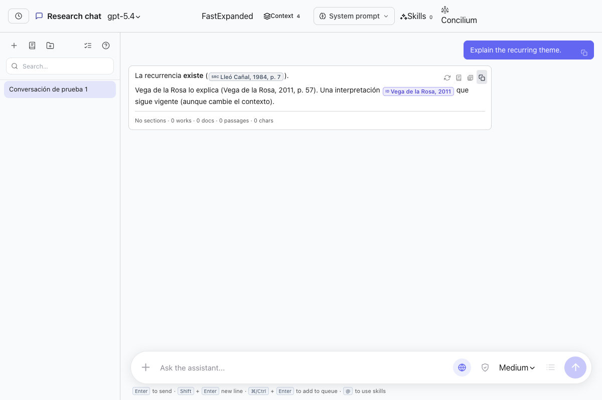
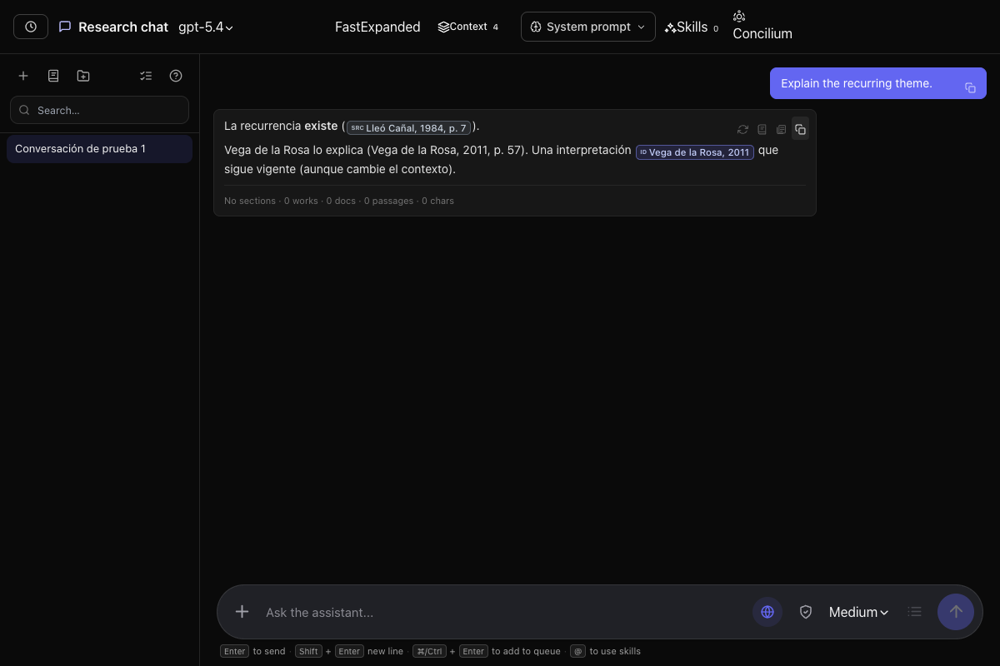
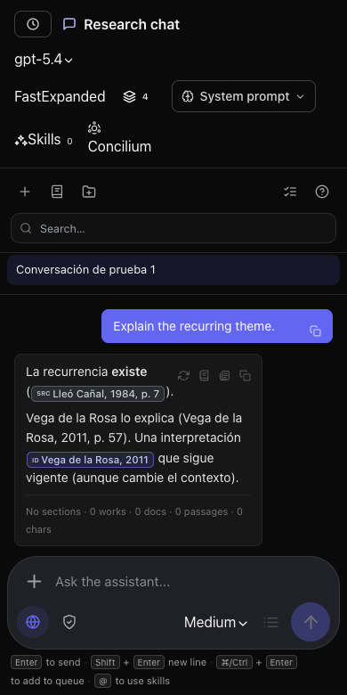
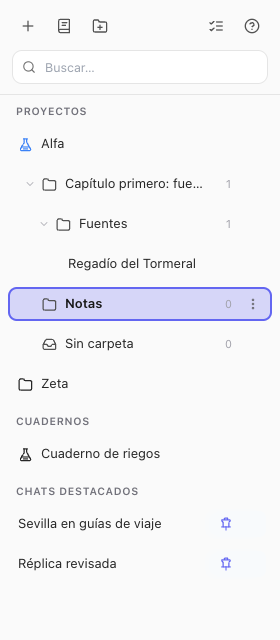
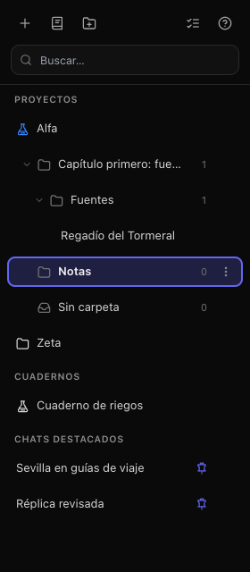

# Research Chat copying and drop feedback

Verified with synthetic conversations and sources in headless Chrome. No provider
requests or private vault data were used.

## Copy actions

Assistant answers now offer **Copy without references** beside the existing
Markdown copy action. The new action reuses Deep Research's `toReadingCopy`:
Nodus citations, author–year parentheses, reference sections, and Markdown
formatting are removed; paragraph breaks and explanatory asides remain.

Author-comma-year Nodus labels and compound surnames such as “de la Rosa” are
recognized by the shared cleaner. This also improves the Deep Research copy.
Success feedback belongs to the action clicked, and enough space is reserved
for all four answer actions.

The tooltip and accessible label reuse the existing **Copy without references**
translation in Spanish, English, French, German, European Portuguese, Brazilian
Portuguese, Italian, Turkish, Simplified Chinese, Traditional Chinese, Japanese,
and Korean. The browser test checks the actual tooltip and clipboard output in
each locale.

## Drop destinations

Accepted folder, project, and “No folder” targets show an accent border and
background with a bold label. The feedback takes precedence over light-theme
hover styles. Moving between a row's children preserves it; leaving, dropping,
ending the drag, or losing window focus clears it. Rejected destinations remain
unhighlighted, and existing folder nesting and reordering are preserved.

## Validation

- `node --test scripts/test-research-chat-copy.mjs scripts/test-research-chat-sidebar.mjs scripts/test-reading-copy.mjs scripts/test-i18n-coverage.mjs`: 55 tests passed.
- `tsc --noEmit -p tsconfig.json --incremental --tsBuildInfoFile /tmp/nodus-research-copy-renderer.tsbuildinfo`: passed.
- `eslint src/views/ResearchAssistantModal.tsx src/components/ResearchChatFolderTree.tsx src/components/ResearchChatSidebar.tsx shared/readingCopy.ts`: passed.
- `git diff --check`: passed.

The existing local dependency installation was missing `acorn-jsx` and
`linkedom`. Their lockfile versions were installed in an isolated temporary
directory for verification; no dependency manifest or lockfile changed.
The full application build and full repository test suite were not run.
