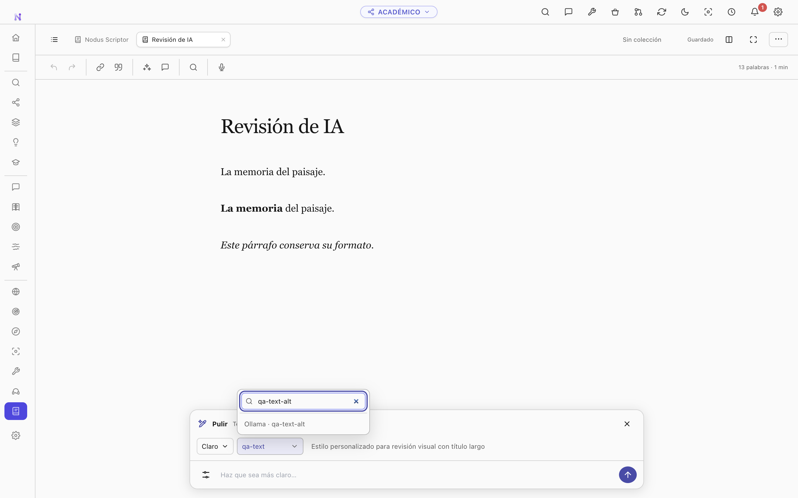
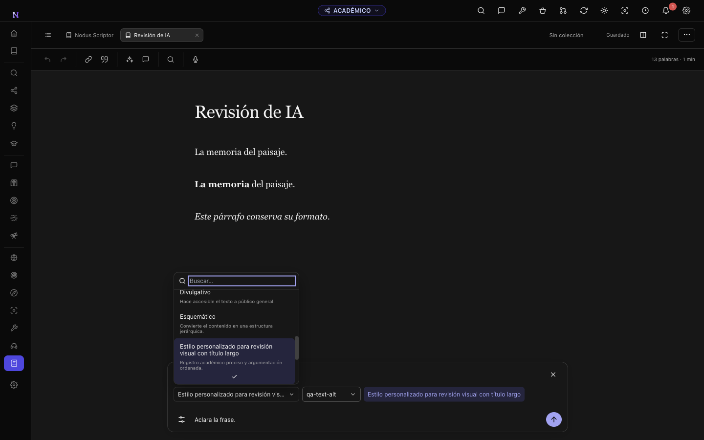
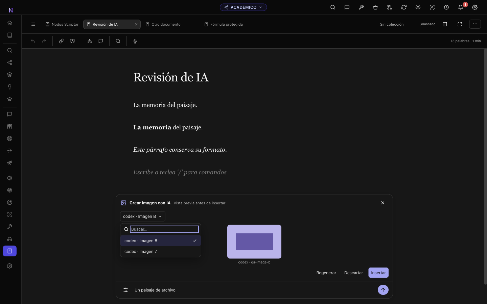
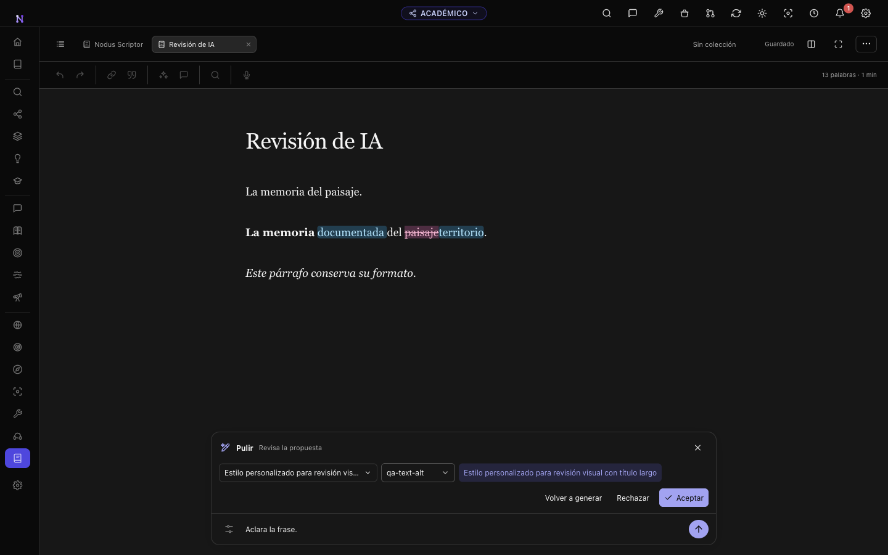
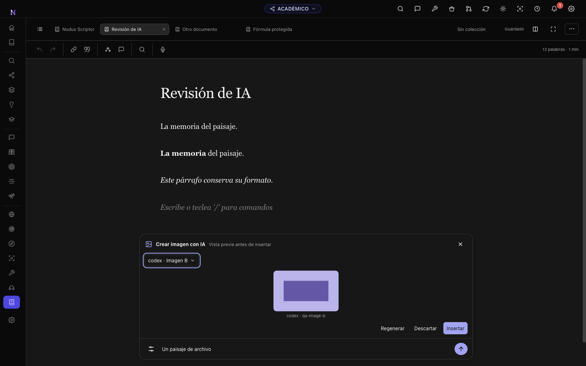
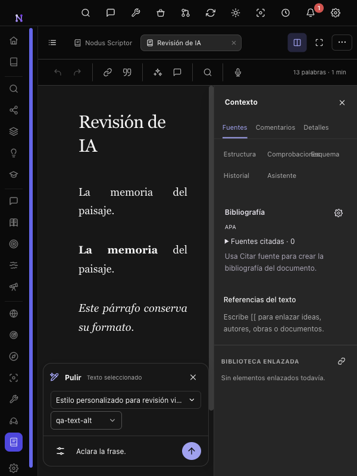

# Scriptor AI polish and image generation

Verified on October 12, 2026 with Nodus 5.8.1 on macOS. These screenshots use synthetic documents and controlled provider responses in isolated temporary profiles. They contain no private vault content, credentials or personal profile paths.

## Workflow

Selecting text exposes **Polish** in the contextual toolbar. The existing prompt manager stays in its current location; applying a library prompt or an inspector shortcut opens the same bottom composer. Styles come from the existing active prompt library, including prompts created or edited from the upper toolbar. Styles and text/image models have searchable selectors ordered alphabetically by their visible labels, with provider and model name ordering for text models. The current/default model keeps its alphabetical position. Pinned prompts remain quick actions. The last style is saved immediately per vault, with Clear as the initial or unavailable-style fallback. Free instructions supplement the style; an empty instruction field applies the style alone.

The composer floats inside the writing area. Its card is opaque, while the editor remains visible around it. It follows Nodus themes and vault accents, leaves the contextual inspector accessible, and scrolls the captured selection above the card. Preview images shrink in short windows so the input and decision controls stay visible. There is a Tools button and no additional plus button.

Text arrives as a provisional inline comparison. Completed proposals use word differences: magenta strikethrough removals and blue additions, with light and dark variants. Native ProseMirror decorations and the temporary Markdown comparison leave the saved document unchanged. Generation and review lock text editing; Accept commits the complete proposal to the exact captured range in one history operation. Reject, close and cancel remove the comparison. Regenerate uses the original selection and current instructions. Decisions use the existing improvement log, and stale responses cannot apply after document changes. Academic atoms are checked before sending a request.

**Create image with AI** is available from Tools and the editor insertion menu without requiring a selection. Its searchable picker includes the configured default and available compatible image favorites. Image favorites have their own settings preference and stars; text favorites stay separate. Choosing another image model affects that generation without changing the global image default.

Images have explicit Preview, Insert, Regenerate and Discard steps. Insertion uses the saved cursor block, replaces an empty paragraph or inserts after a populated block, and retains the original image bytes in the existing embedded storage. If the destination disappears, insertion requires a new explicit cursor position. Markdown acceptance and image insertion return focus to the editor.

This change covers the shared desktop editor in Notes, Study and Teaching. Web receives no new AI workflow.

## Data, network access and compatibility

No database migration is introduced. The last style is vault-specific; image favorites are shared settings stored separately from text favorites. Review decorations are temporary and never enter native JSON. Images enter document storage only after Insert.

Polishing sends the captured selection, chosen style, additional instructions and existing task metadata/protected terms only after the user submits. Image generation sends the user's description to the explicitly chosen existing provider. The composer does not automatically attach the document, course, roster, grades or student answers to an image request, or add background generation or student evaluation. Existing provider-key, session and local-runtime checks remain in use.

`StudyImproveRequest.additionalInstructions` is optional, preserving existing consumers. Editor image generation and cancellation have request identifiers; cancelled non-abortable provider output is discarded.

## Verification

[Flow results](results.json) cover 140 real-editor captures across light/dark themes and all five requested viewport sizes: 1920×1080, 1440×900, 1280×800, 900×700 and 600×800. Visual review includes compose, searchable menus, streaming, review, errors, image generation and preview, inspector, focus, Markdown and a selection near the bottom of a long document.

The main Electron E2E uses controlled AI responses while exercising the real editor, preload IPC and vault storage. It covers repeated-text selection, paragraph-spanning changes, native marks and IDs, academic/formula preflight, fragmented streaming, empty/error responses, cancellation, late responses, prompt creation, style persistence/fallback, image favorites/model overrides, original bytes, explicit retargeting of a deleted anchor, Markdown insertion, persistence and exact undo in Notes, Study and Teaching.

The [provider integration results](provider-results.json) use the unmodified study service, native provider transport and improvement log against a controlled local Ollama endpoint. They verify streaming, additional instructions, reject/accept logging, undo/redo, reload persistence, provider cancellation and empty responses. No live paid provider requests were made during these checks.

Focused unit/component/contract/translation checks passed 56 tests. Another 13 real-component checks passed, covering alphabetical options, search, selected IDs and keyboard navigation, including saved non-favorite models. Relevant editor/storage/model regressions, desktop typecheck/build and the web build passed. The existing Scriptor action and polish E2Es and the general Electron smoke suite also passed.

## Screenshots

Searchable text model in the bottom composer:



Alphabetical styles from the existing prompt library and compatible image models:





Temporary word differences and whole-proposal decisions:



Image preview over the visible editor background:



Composer and contextual inspector at 600×800:



## Reproduction

Build the desktop app first. The scripts create and delete their own isolated temporary profiles.

```sh
npm run build
node --test scripts/test-scriptor-ai-review.mjs scripts/test-scriptor-editor-images.mjs scripts/test-scriptor-image-favorites-ui.mjs scripts/test-study-improve-ui.mjs scripts/test-study-improve.mjs scripts/test-ipc-contract.mjs scripts/test-i18n-coverage.mjs scripts/test-model-prefs-recovery.mjs
node --test scripts/test-model-picker-search.mjs
npm run test:e2e
node scripts/e2e-scriptor-ai-review.mjs
node scripts/e2e-scriptor-provider.mjs
node scripts/e2e-scriptor-actions.mjs
node scripts/e2e-scriptor-polish.mjs
npm run build:server-web
```

The main E2E regenerates the complete searchable gallery at `output/qa/scriptor-ai-review/index.html`. The component image-favorites check requires an installed Chrome/Chromium browser.
