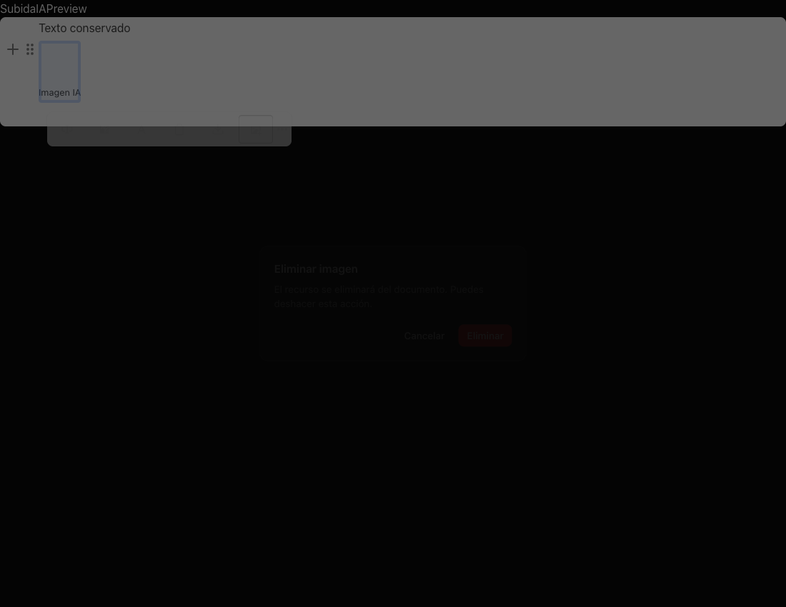

# Scriptor citation and image regression verification

## Behavior

The citation picker remains dismissible with its close button, Cancel, Escape,
and backdrop while source searches or selected-source details are pending.
Superseded requests cannot replace newer results or reopen a dismissed dialog.
Parent renders do not restart a search. Selecting another source preserves
bibliographic corrections and the open metadata editor.

Desktop source search uses two bounded local queries, rather than fetching
details for every result. Complete details are requested for selected sources.
The existing Zotero detail request has a 1.5-second timeout in this flow; local
metadata remains usable when Zotero is unavailable.

The image toolbar opens the shared confirmation dialog before removal. Uploaded
and AI-generated images follow the same path. Cancel receives initial focus;
Cancel, Escape, and the backdrop preserve the image. Confirmed removal remains
undoable.

The screenshot uses production editor and confirmation components with synthetic
content. It contains no user document or vault data.

## Storage and privacy

Desktop uploads and generated images use the existing vault asset store. Saving
an existing inline-media draft moves its binary payload to `db_blobs` before
native document and page-block size validation. Native JSON and Markdown retain
`nodus-blob://` references; page blocks register their attachment hashes in
`page_block_blobs`.

This reuses existing tables without a schema migration. Binary content is
preserved byte for byte and identical payloads are stored once. Failed document
saves roll back newly stored assets. Text size limits remain enforced. Editor
and Markdown previews resolve local references through the existing asset API,
and editor object URLs are released on unmount. Downloads retain the image
bytes.

Local asset rendering is injected by Scriptor into the shared Markdown renderer.
The shared renderer does not import the editor's attachment store, so Nodi's
overlay keeps its existing restricted preload without vault asset read/write
methods. Scriptor's split preview opts into the same local image renderer used
by the native editor.

The change adds no external service or AI request. Source lookup reads local
metadata, and selecting a vault source can use the existing local Zotero API.
Asset bytes stay in the vault database; no backup implementation or
synchronization schema is changed.

## Validation

The following focused checks passed locally:

- `npm run typecheck` for renderer and Electron.
- ESLint for all changed TypeScript and TSX files.
- `scripts/test-academic-citation-dialog.mjs`: pending search/details dismissal,
  focus restoration, stale results, parent renders, source insertion,
  bibliographic corrections, and delivery busy-state isolation.
- `scripts/test-academic-source-search.mjs`: bounded local lookup, DOI
  deduplication, selected-source hydration, and unavailable Zotero/global library.
- `scripts/test-editor-image-confirmation.mjs`: real editor image rendering,
  confirmation and cancellation for both image origins, undo, downloads,
  PNG/SVG Markdown previews, and React Strict Mode.
- `scripts/test-blocknote-storage.mjs`: existing notes/study regressions plus
  large inline-media recovery, byte preservation, deduplication, references,
  Markdown input, rollback, and unchanged text limits.
- `scripts/test-editor-references.mjs`: work-only search, creator/year filters,
  result limits, literal wildcard handling, and existing reference behavior.
- `scripts/test-window-preloads.mjs`: real secondary-window bundle dependencies
  match their bridges, and shared Markdown does not give Nodi vault asset APIs.
- `scripts/test-server-generated.mjs`: committed server modules match their
  shared sources after regeneration with `npm run build:server-shared`.
- Academic Scriptor, academic interface, Server Web academic parity, Scriptor AI
  review, editor images, navigation, and internationalization coverage suites.

The complete `npm test`, production build, and full desktop smoke suite were not
run locally. Repository CI remains responsible for those broader checks.
