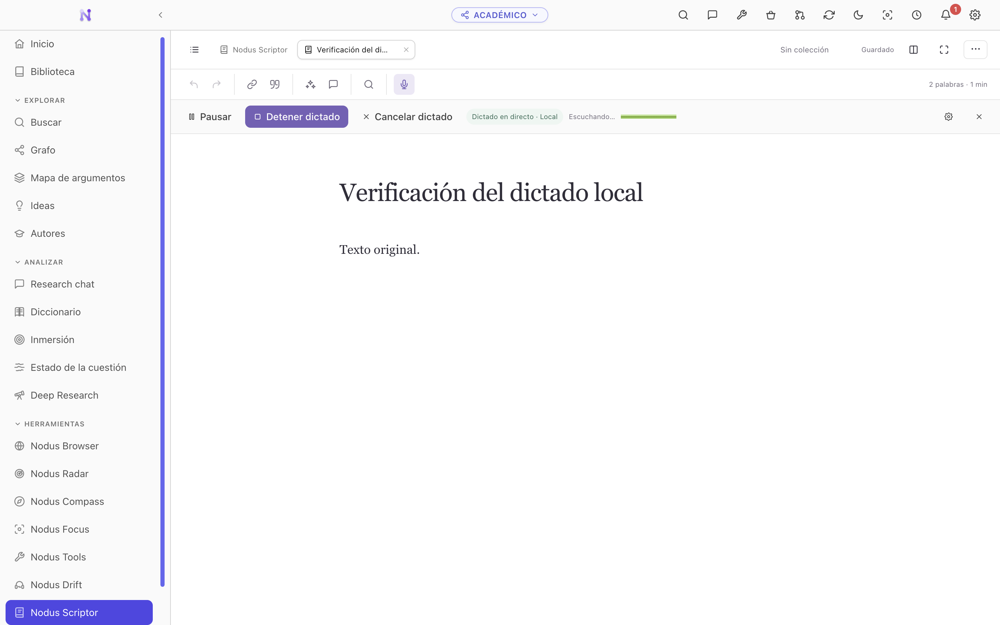
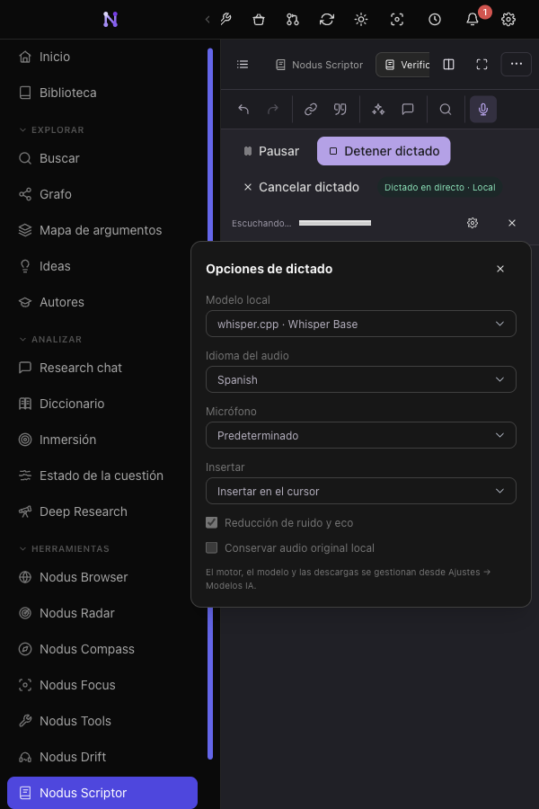
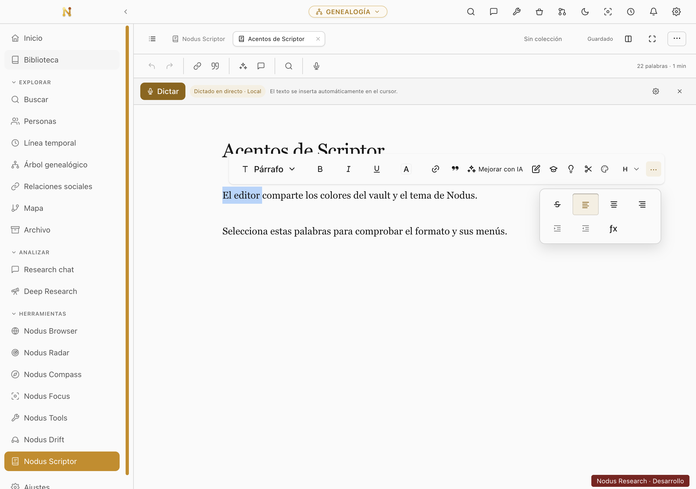
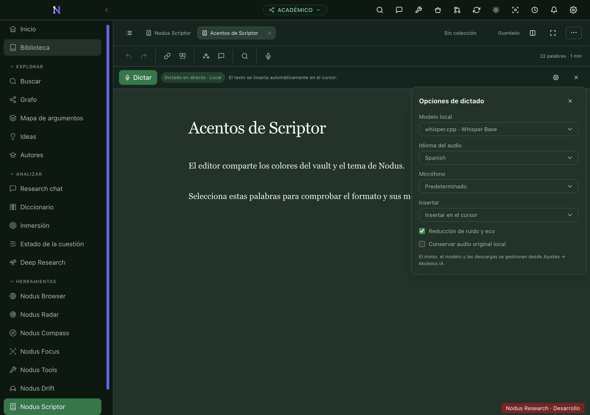

# Scriptor live local dictation and shared accents

Verified on October 11, 2026 with Nodus 5.8.1 on macOS. Documents and speech in
these captures are synthetic test fixtures. The screenshots and sanitized
[results](results.json) contain no personal vault content or local profile paths.

## Behavior

The Scriptor microphone action starts dictation with an installed local model.
Recognized speech updates an ordinary text range at the cursor or replaces the
selected range. Provisional words can be revised as more audio arrives; pauses
finalize the utterance. Saving, editing and undo/redo use the normal editor.

Pause and resume retain the session. Stop drains the final audio before releasing
the microphone and model. Cancel ignores late results. Switching documents drains
and saves the originating document without dictating into the destination.

Dictation settings open in an independent popover with local model, language,
microphone, insertion target, noise reduction and optional audio preservation.
The formatting toolbar's More button also opens an independent popover, retaining
the selected words and keyboard access without adding a scrollbar inside the bar.

Scriptor inherits the active vault's accent with the default app theme. A chosen
built-in or custom theme takes precedence. Buttons, selected options, badges and
portalled menus share the app palette in light and dark modes.

## Recognition and privacy

Audio is captured and resampled through a worklet at 16 kHz. Growing utterance
windows retain context, coalesce intermediate requests and run one inference at
a time. Long utterances carry overlapping audio across the model window. Silence
gating, marked sound-caption filtering and repetition checks reduce hallucinated
output; provisional trailing sentence endings are withheld until finalization.
Recognition latency depends on the selected model and hardware. Backpressure
pauses capture rather than accumulating an unbounded audio queue.

ONNX inference uses the local worker and installed model cache. whisper.cpp keeps
a model resident in a session-owned `whisper-server` process bound to `127.0.0.1`
on a dynamically chosen port with a random request path. Electron main sends audio
to that loopback process; this introduces local HTTP traffic, not an external
transcription service. Live dictation has no cloud-provider fallback or automatic
model download. Models and runtimes remain managed through Settings.

Live whisper.cpp requires `whisper-server` beside the configured `whisper-cli`.
An older installation without that binary receives an actionable startup error.
Existing recording transcription retains its CLI route. Microphone permission
and the app's privacy confirmation remain part of startup. Audio persistence is
optional and local; reprocessing a saved clip does not duplicate document text.
No database migration or new external service is introduced.

## Evidence

- The source UI fixture passed 11 checks covering growing editable text, final
  punctuation, undo/redo, pause/resume, cancel, document switching, adjacent user
  edits, native and Markdown modes, popover bounds, local clips and error paths.
- The real Electron application passed five checks using actual local Whisper
  inference and prerecorded synthetic Spanish speech through the production
  capture worklet and IPC. Animations remained enabled. A 225-frame audit found
  stable UI, and reload preserved the document without restarting the microphone.
- A separate approximately 32.5-second, 103-word synthetic Spanish sample produced
  52 live updates with word error rate `1/103`. Silence and a 220 Hz tone produced
  empty transcripts; the resident process was released. These are fixture results,
  not a general accuracy or latency guarantee.
- Formatting passed eight viewport/theme combinations from 360 to 1280 pixels,
  including independent positioning, no toolbar scrolling, keyboard activation,
  alignment, preserved selection and undo.
- Accent verification passed 48 theme/mode/vault combinations: all 16 built-in
  palettes, the default and a custom palette, and actual Academic, Genealogy and
  Databases vaults. It checked the settings and formatting portals, theme
  precedence, unchanged document text and readable controls. Minimum contrast was
  4.84:1 for primary button text, 4.56:1 for accent text and 8.78:1 for document and
  popup text.
- Full lint and renderer/Electron typecheck passed. The STT, live-dictation and
  internationalization checks passed 59 tests; the editor and theme checks passed
  another 96 tests. The production renderer build passed.

The live-model captures below precede the final palette update; they document
capture and popover behavior. The vault and custom-theme captures show the final
shared palette and independent formatting popover.









## Reproduction

```sh
npm run lint
npm run typecheck
node --test scripts/test-live-dictation.mjs scripts/test-study-stt.mjs scripts/test-i18n-coverage.mjs scripts/test-i18n-no-duplicate-keys.mjs
node --test scripts/test-runtime-themes.mjs scripts/test-vault-accent-remaps.mjs scripts/test-theme-contrast.mjs scripts/test-server-web-theme.mjs scripts/test-study-editor.mjs scripts/test-academic-scriptor.mjs
npm run verify:scriptor-dictation
```

After building the desktop application:

```sh
NODUS_DICTATION_CPP_MODEL=/path/to/ggml-base.bin node scripts/verify-whisper-realtime.mjs
NODUS_DICTATION_CPP_MODEL=/path/to/ggml-base.bin node scripts/e2e-scriptor-dictation.mjs
node scripts/e2e-scriptor-formatting.mjs
node scripts/e2e-scriptor-accents.mjs
```

The long-speech audit requires macOS `say`, the Mónica voice, `ffmpeg` and the
installed whisper.cpp runtime. The desktop audit accepts
`NODUS_DICTATION_AUDIO_FILE` for a prerecorded Spanish WAV on other platforms.
The source fixture accepts `NODUS_CHROME_PATH` for its Chromium executable.
Model availability is stubbed only for the accent audit's model selector; it
rejects the microphone privacy prompt before capture. Recognition is real in the
separate local-model audits. Scratch profiles are isolated from personal vaults.

`scripts/launch-scriptor-dictation-preview.mjs` opens a separate manual preview
with real microphone input and copies of installed whisper.cpp weights. It
leaves its independent profile available for testing and does not modify the
source profile or copy credentials.
