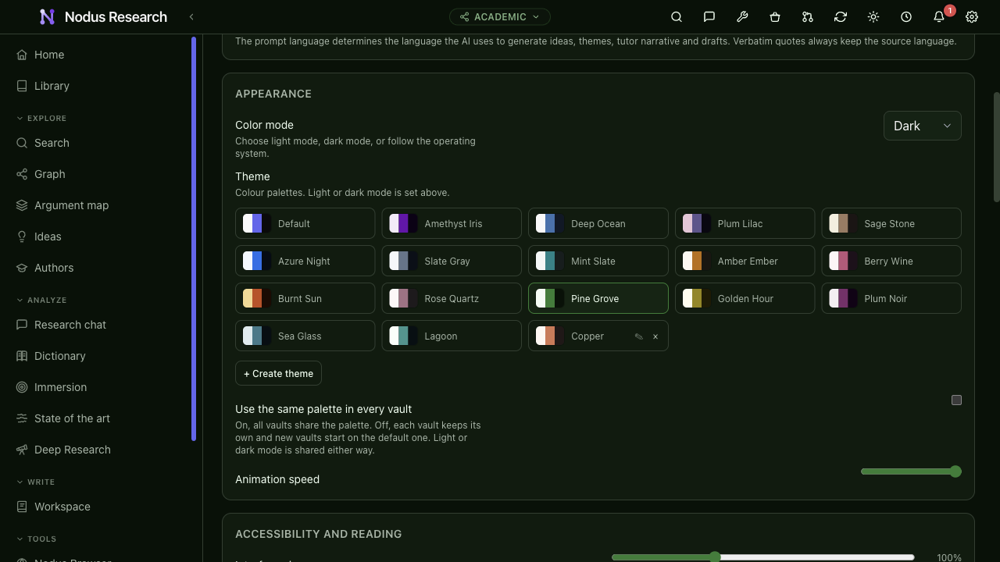
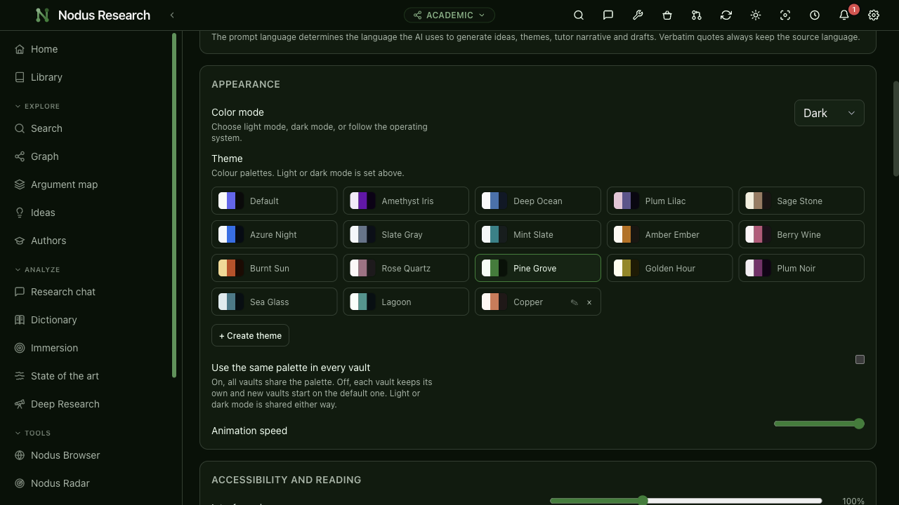
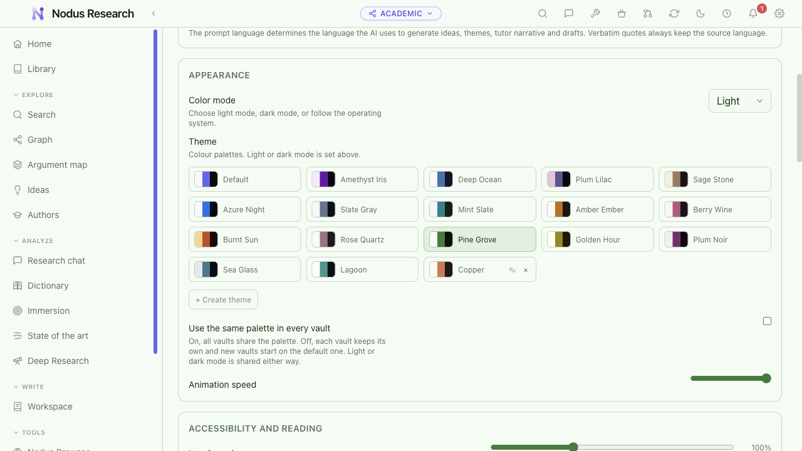
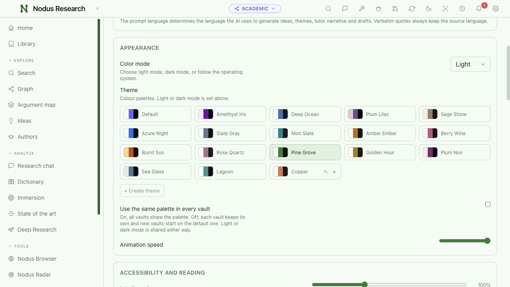
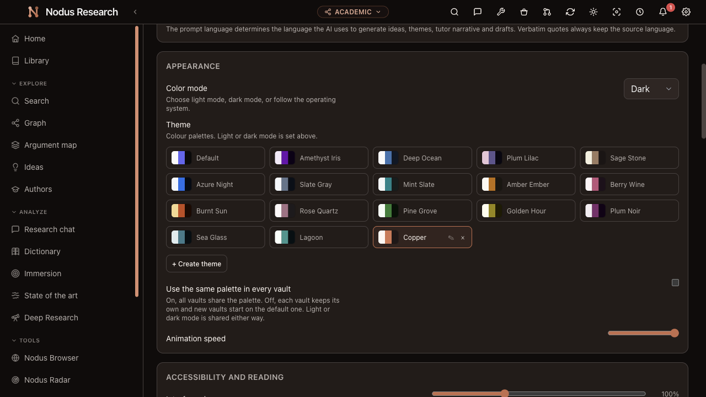
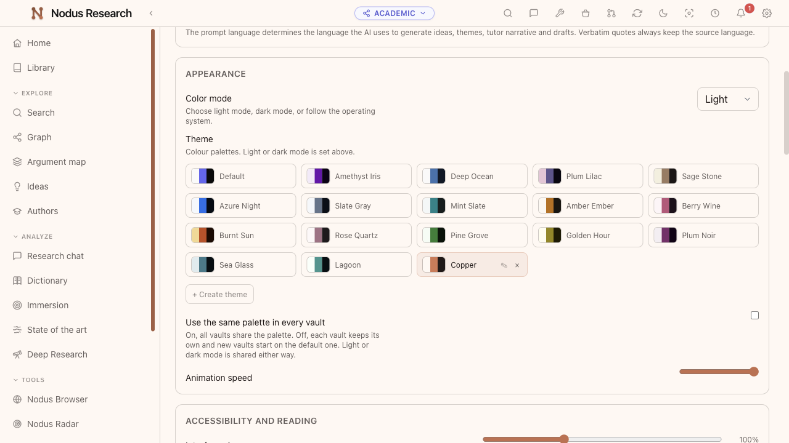

# Header logo and sidebar scrollbar themes

The left navigation scrollbar and header mark follow the selected application
palette in desktop Nodus and Nodus Server. The default palette retains the
original vault-specific scrollbar colour and SVG artwork.

The themed mark uses the canonical geometry in `shared/nodusMark.json` and live
CSS variables for its gradient and nodes. Chrome accents select the dark or light
ramp explicitly, including system-mode changes. The scrollbar rules cover both
the standard `scrollbar-color` property and the WebKit thumb, with enough
specificity to override the generated neutral scrollbar rules.

## Verification

Run against a built desktop app:

```sh
npm run build
node scripts/verify-shell-theme.mjs
```

The script creates and removes a disposable profile, uses the actual Settings
controls without reloading between palettes, and checks computed colours for:

- All 16 built-in palettes and a synthetic custom Copper palette in light/dark.
- System-mode preference changes in both directions.
- Restoring the default artwork and scrollbar in academic, study and genealogy vaults.
- Both scrollbar implementations, all logo nodes and gradient stops, and renderer errors.

Result: 39 combinations passed; no renderer errors. Lint, typecheck, desktop and
server-web builds, and 126 focused theme/sidebar/vault tests also passed.

## Screenshots

Captured from Nodus 5.9.1 on macOS in isolated profiles with synthetic settings
and empty vaults. Before images use an existing unmodified desktop build.

| Pine Grove | Before | After |
| --- | --- | --- |
| Dark |  |  |
| Light |  |  |

| Custom Copper, dark | Custom Copper, light |
| --- | --- |
|  |  |
